<div align="center" dir="rtl">


# مركز

### نظام ERP عربيّ أولاً للشركات في السعودية والخليج

**المحاسبة · المبيعات · المشتريات · المخزون · الرواتب · الأصول الثابتة · الفوترة الإلكترونية (زاتكا) · المساعد الذكي**

<a href="README.md"></a>
<a href="docs/wiki/Home.md"></a>


**🇬🇧 English version of this file — [Click here](README.md)**

</div>

<br>

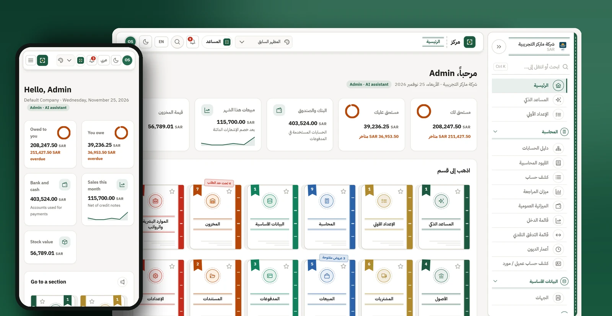

<br>

<div dir="rtl">

**مركز** نظام محاسبي وتجاري متكامل صُمّم لطريقة عمل الشركات في السعودية والخليج فعلاً: **العربية
والإنجليزية من اليوم الأول**، من اليمين لليسار ومن اليسار لليمين، **الفوترة الإلكترونية لزاتكا مدمجة**،
ودفتر أستاذ عام **تحمي قاعدة البيانات نفسها توازنه**.

يُباع **بشراء لمرة واحدة**، ويُنشر **بشكل معزول لكل عميل**: قاعدة بيانات خاصة وخادم خاص، على أجهزة
العميل أو على حساب سحابي يملكه.

---

## ✦ لماذا مركز؟

<table>
<tr>
<td width="33%" valign="top">

### ⚖️ دفاتر لا تكذب
كل قيد محاسبي متوازن **بقيد (Trigger) على مستوى قاعدة البيانات**، والسجلات المرحّلة **لا تُعدّل ولا
تُحذف**، والمبالغ أرقام عشرية دقيقة لا أرقام عائمة.

</td>
<td width="33%" valign="top">

### 🇸🇦 جاهز لزاتكا
ملفات UBL 2.1 موقّعة، ورمز QR مشفّر، واعتماد (Clearance) وإبلاغ (Reporting)، وسجل كامل للإرسال،
داخل حزمة امتثال معزولة.

</td>
<td width="33%" valign="top">

### 🌍 ثنائي اللغة فعلاً
كل شاشة وملف PDF وبريد ورسالة خطأ **بالعربية والإنجليزية**، مع انعكاس كامل للاتجاه، ووضع ليلي،
ودعم للجوال.

</td>
</tr>
<tr>
<td valign="top">

### ✨ ذكاء اصطناعي يستأذنك
اسأل بالعربية أو الإنجليزية. يجهّز المساعد الفواتير والسندات والقيود على شكل **بطاقات توافق عليها
بنفسك**، ولا ينفّذ شيئاً من وراء ظهرك.

</td>
<td valign="top">

### 🔗 كل شيء مترابط
عرض سعر ← أمر بيع ← إشعار تسليم ← فاتورة ← سند قبض. كل مستند مرتبط بما قبله وما بعده، ويُرحَّل إلى
الأستاذ العام تلقائياً.

</td>
<td valign="top">

### 🔐 آمن افتراضياً
صلاحيات مرفوضة ما لم تُمنح صراحةً، وسجل تدقيق لا يستطيع التطبيق نفسه تعديله، ومفاتيح مشفّرة، وتدوير
لرموز الجلسات.

</td>
</tr>
</table>

---

## ✦ جولة في المزايا

> كل قسم هنا نبذة مختصرة. للشرح التفصيلي اضغط **الدليل التفصيلي ←** (صفحات الويكي باللغة الإنجليزية).

### 📒 المحاسبة والأستاذ العام

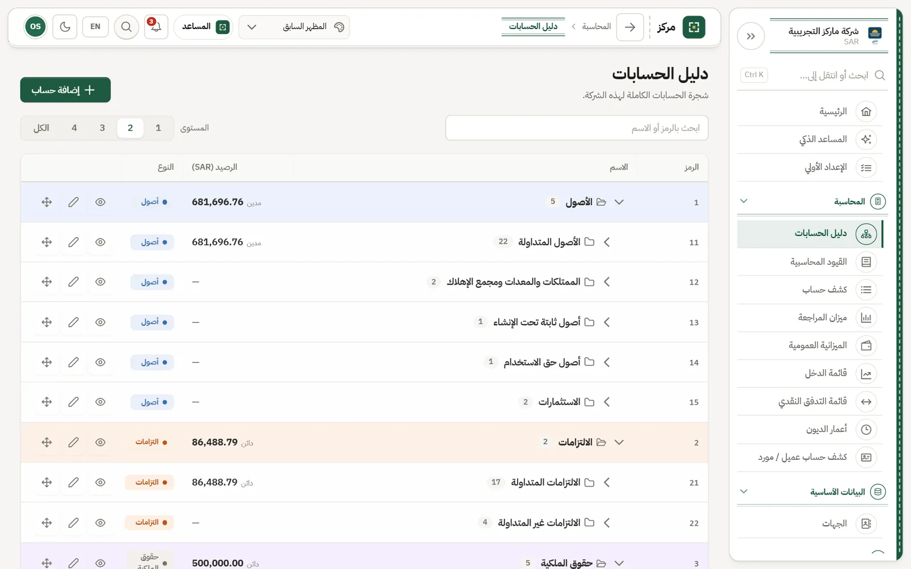

دليل حسابات متعدد المستويات بأرصدة حيّة، وقيود يومية يدوية مع مراكز التكلفة والمرفقات، وعكس القيد بضغطة
واحدة، وسنوات وفترات مالية، وربط حسابات قابل للتخصيص. ميزان المراجعة، والميزانية العمومية، وقائمة الدخل،
وقائمة التدفق النقدي، وكشف الحساب — طباعة أو PDF أو CSV.

**[الدليل التفصيلي ←](docs/wiki/Accounting.md)**

### 🧾 المبيعات والذمم المدينة

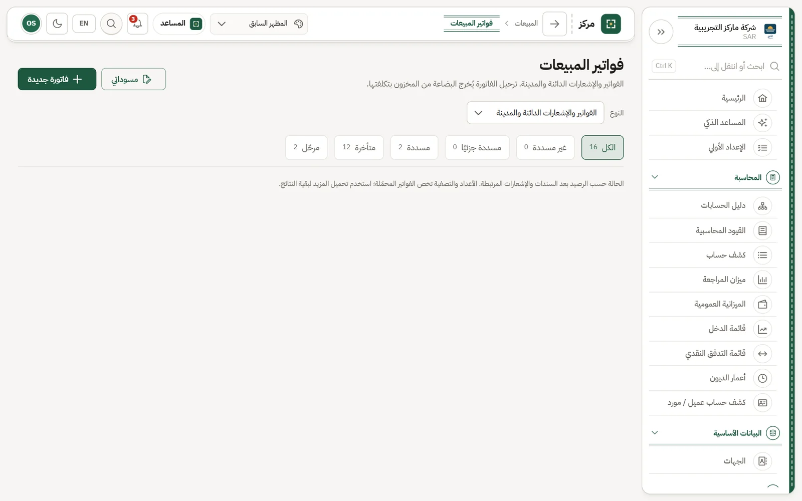

عروض أسعار تُرسل بالبريد كملف PDF بهوية شركتك، وأوامر بيع، وإشعارات تسليم، وفواتير، وإشعارات دائنة
ومدينة، ومرتجعات بالكميات مرتبطة بالفاتورة الأصلية. تعرض كل فاتورة حالة سدادها والرصيد المتبقي، ويُرحَّل
الإيراد والضريبة والذمم وتكلفة البضاعة المباعة في عملية واحدة.

**[الدليل التفصيلي ←](docs/wiki/Sales-and-Receivables.md)**

### 🛒 المشتريات

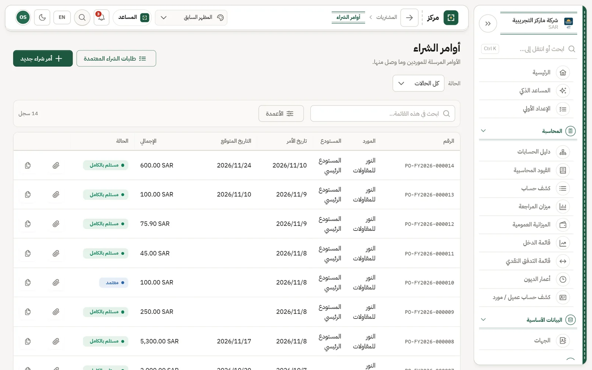

طلبات شراء مع مراجعة وسياسة موافقات، وأوامر شراء تبدأ من الطلبات المعتمدة، واستلام في المستودعات، وفواتير
موردين بالمطابقة الثلاثية، ومرتجعات مشتريات مبنية على الفاتورة، ورموز ضريبية.

**[الدليل التفصيلي ←](docs/wiki/Purchasing.md)**

### 📦 المخزون

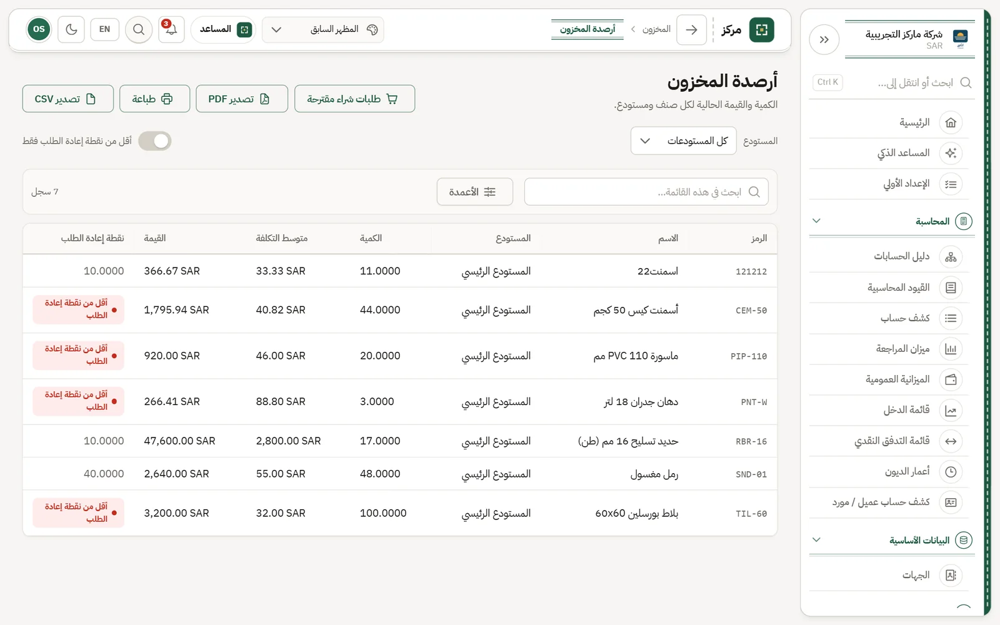

أصناف بالصور وحدود إعادة الطلب، ومستودعات متعددة، وتكلفة بالمتوسط المرجّح، وحركات مخزون، وسندات استلام
وصرف، وجرد. واقتراحات إعادة التزويد تحوّل النقص في المخزون إلى طلبات شراء قابلة للمراجعة.

**[الدليل التفصيلي ←](docs/wiki/Inventory.md)**

### 💳 المدفوعات والنقدية والمصروفات

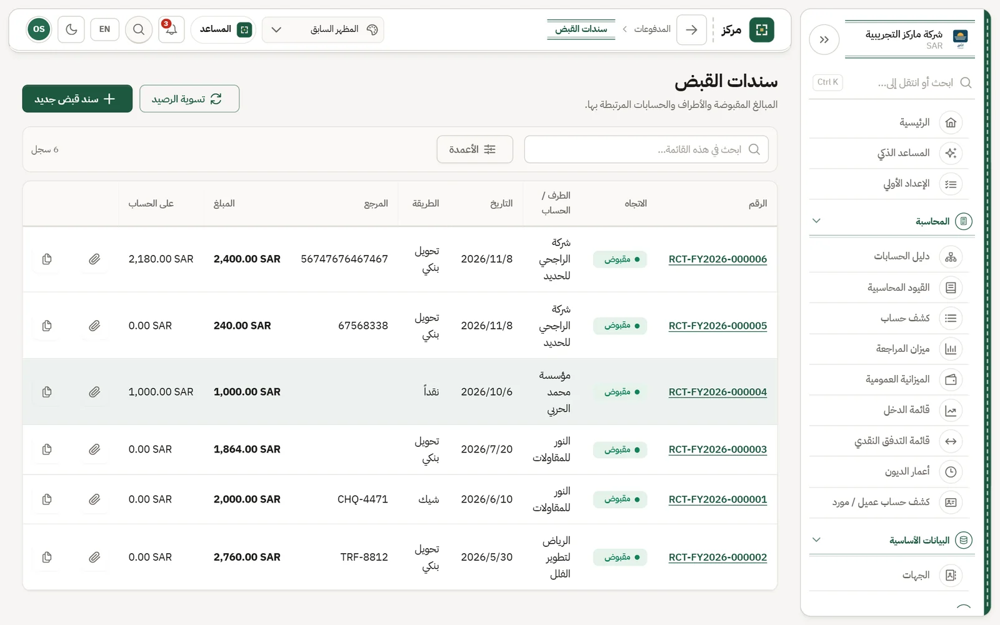

سندات قبض وصرف للعملاء والموردين والموظفين أو أي حساب، مع تخصيص المبالغ على الفواتير عبر «سدّد الآن».
ومصروفات نقدية متعددة البنود بمراكز تكلفة، وتقارير أعمار الديون، وكشوف حساب العملاء والموردين.

**[الدليل التفصيلي ←](docs/wiki/Payments-and-Cash.md)**

### 👥 الموارد البشرية والرواتب

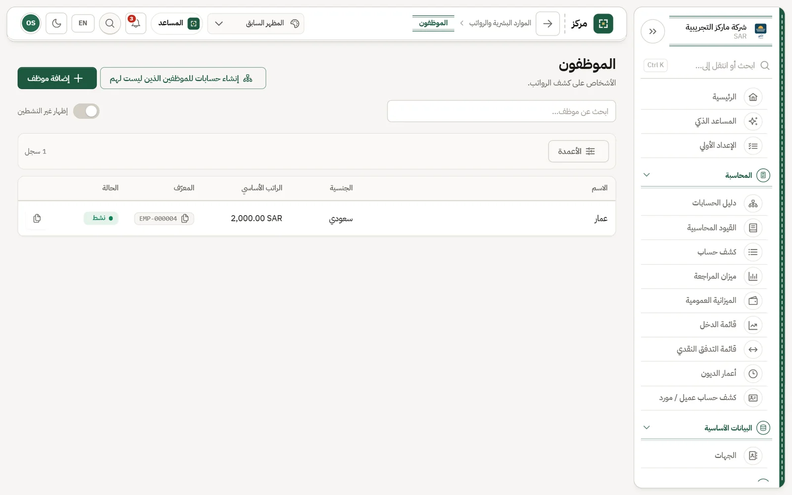

الموظفون وأنواع البدلات، ومسيرات رواتب تُرحَّل مباشرة إلى الأستاذ العام، والتأمينات الاجتماعية (GOSI)،
وملف حماية الأجور (WPS) للبنك، والسلف مع جدولة استردادها، وتسويات مكافأة نهاية الخدمة.

**[الدليل التفصيلي ←](docs/wiki/HR-and-Payroll.md)**

### 🏢 الأصول الثابتة

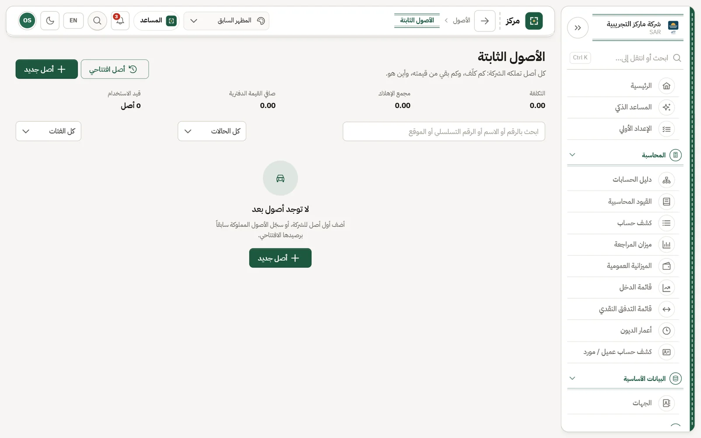

فئات الأصول، وسجل كامل (رسملة، أصول افتتاحية، نقل)، ودورات إهلاك شهرية بالقسط الثابت مع معاينة وإمكانية
العكس، واستبعاد الأصول، وتقارير مطابقة مع الأستاذ العام.

**[الدليل التفصيلي ←](docs/wiki/Fixed-Assets.md)**

### 🇸🇦 الفوترة الإلكترونية — زاتكا

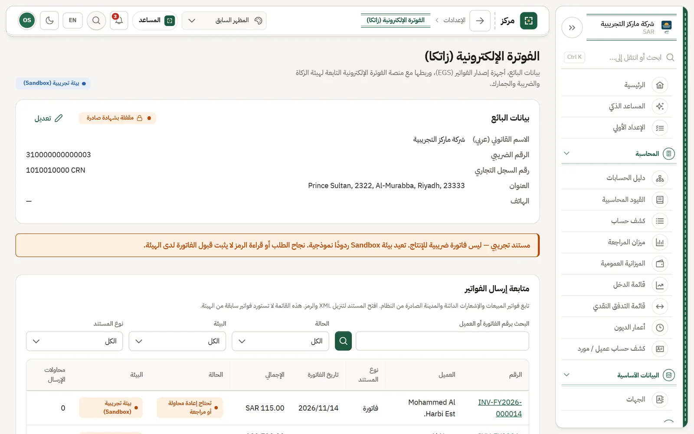

ملف البائع، وتسجيل وحدات EGS مع طلب الشهادة (CSR) والحصول على CSID، وملفات UBL 2.1 موقّعة لأنواع
المستندات الستة، ورمز QR، والاعتماد والإبلاغ، وإعادة المحاولة، وسجل إرسال كامل. المفاتيح مشفّرة ولا تغادر
الخادم أبداً.

**[الدليل التفصيلي ←](docs/wiki/ZATCA-E-Invoicing.md)**

### ✨ المساعد الذكي وMCP

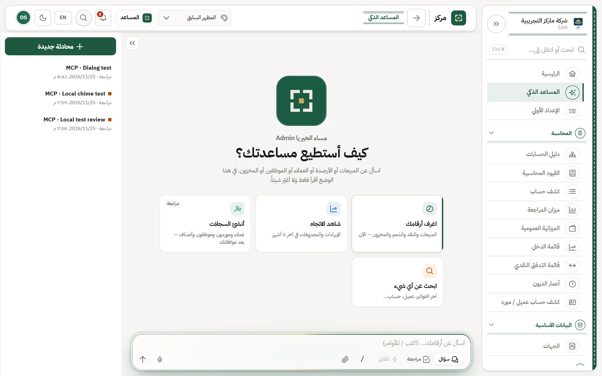

اسأل عن الأرصدة أو المبيعات أو المخزون، وابحث عن أي مستند، ودع المساعد يجهّز السجلات كبطاقات موافقة قابلة
للتعديل. ثلاثة أوضاع (سؤال، مراجعة، تلقائي)، وإدخال صوتي، واختيار مزوّد الذكاء الاصطناعي — وخادم MCP
يتيح لـ Claude وCursor وVS Code العمل على دفاترك عبر رموز وصول محددة الصلاحيات.

**[الدليل التفصيلي ←](docs/wiki/AI-Assistant.md)**

### 💬 بوتات المحادثة

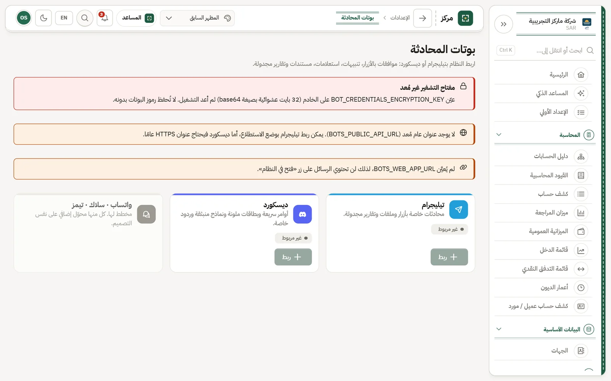

اربط تيليجرام أو ديسكورد للموافقات والاستعلامات والمستندات والتقارير المجدولة داخل المحادثة — كل إجراء
باسم مستخدم مرتبط، مع إعادة التحقق من الصلاحية عند كل ضغطة.

**[الدليل التفصيلي ←](docs/wiki/Chat-Bots.md)**

### 📎 المستندات والتقارير والمنصّة

| | |
|---|---|
| **المسودات والمرفقات** | مسودات خاصة تُحفظ تلقائياً، ومستندات ممسوحة على كل سجل، وتسلسل المستندات وسجل النشاط — [الدليل](docs/wiki/Documents-and-Workflow.md) |
| **التقارير ولوحة التحكم** | مؤشرات حيّة، وقوائم مالية، وأعمار ديون، وتقارير مخزون وأصول مع تصدير PDF/CSV — [الدليل](docs/wiki/Reports-and-Dashboard.md) |
| **الأمان والإدارة** | المستخدمون والأدوار والصلاحيات، وسجل تدقيق غير قابل للتعديل، والإعداد الأوّلي — [الدليل](docs/wiki/Security-and-Administration.md) |
| **الواجهة** | ثلاثة أنماط تصميم، ولوحات ألوان، ووضع ليلي، وبحث سريع `Ctrl K`، وجوال، وتطبيق قابل للتثبيت (PWA)، وقراءة دون اتصال — [الدليل](docs/wiki/Interface-and-Localization.md) |

---

## ✦ منتج واحد بلغتين

<table>
<tr>
<td width="50%">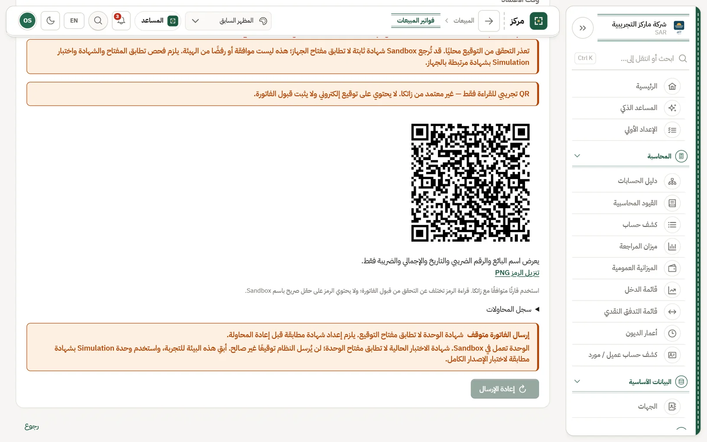</td>
<td width="50%">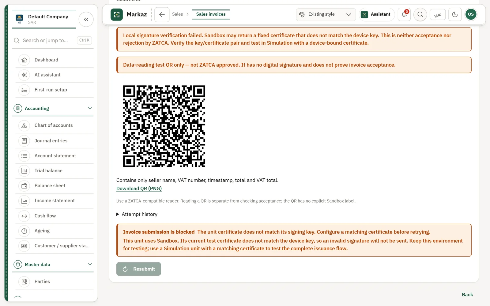</td>
</tr>
<tr>
<td>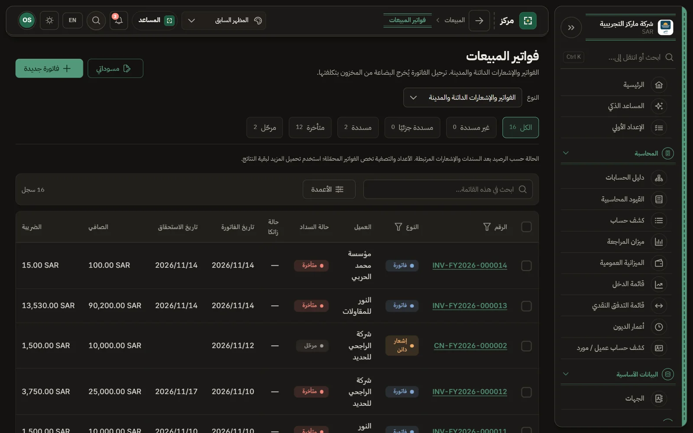</td>
<td>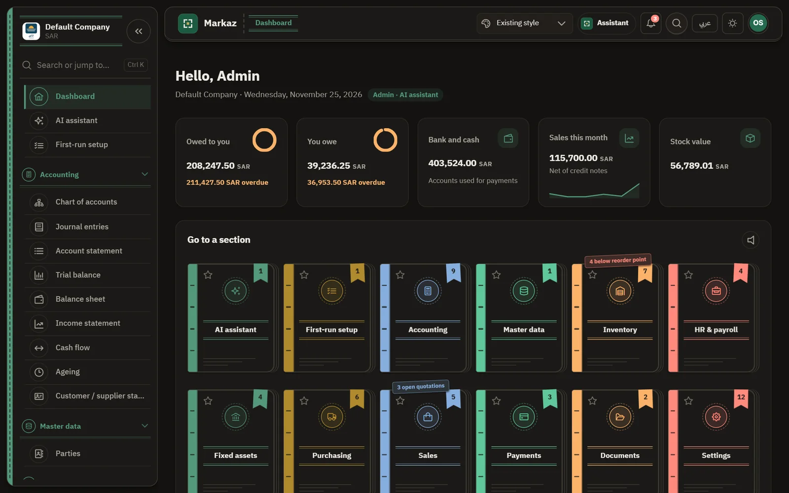</td>
</tr>
</table>

<p align="center">
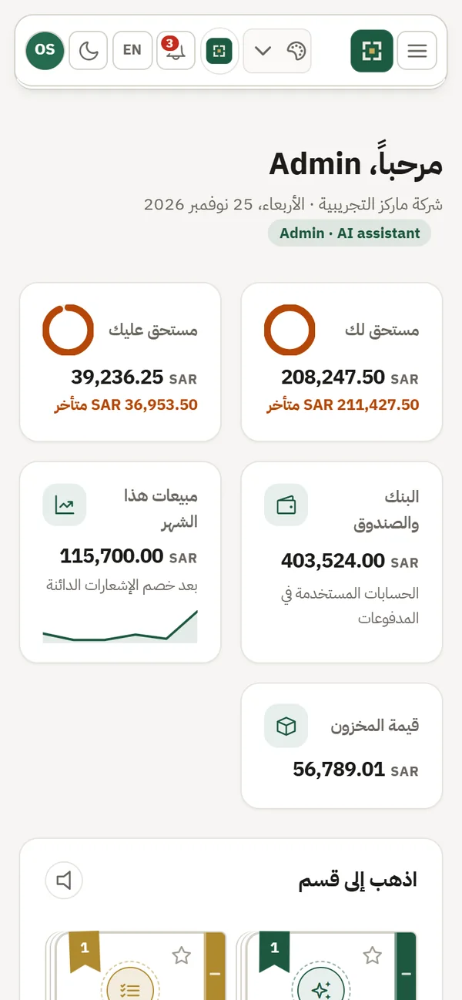
&nbsp;&nbsp;
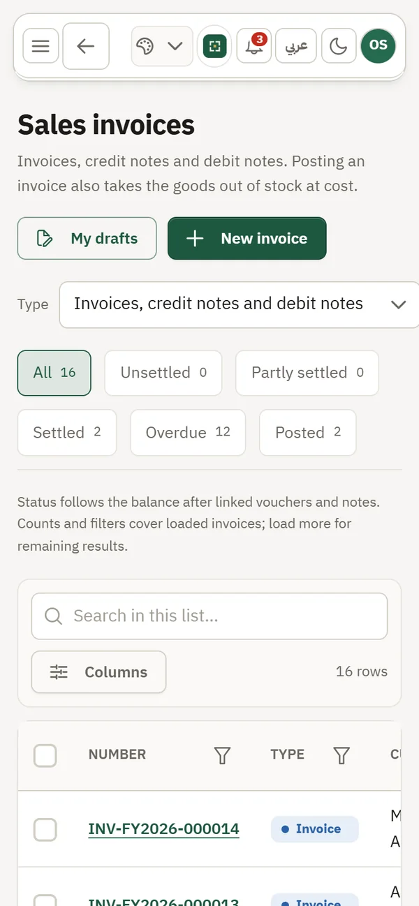
</p>

---

## ✦ هندسة تليق بنظام سجلات مالية

| الضمان | كيف يتحقق |
|---|---|
| **أستاذ عام متوازن** | قيد مؤجّل في قاعدة البيانات يتحقق من تساوي المدين والدائن (بعملة العملية وبالعملة الأساسية) عند الحفظ |
| **الفترات المقفلة** | قيد يمنع الترحيل إلى فترة مالية مقفلة |
| **سجل لا يتغيّر** | القيود وسجل التدقيق تُكتب عبر مستخدم قاعدة بيانات لا يملك صلاحية `UPDATE` أو `DELETE` |
| **مبالغ دقيقة** | `Decimal(19,4)` مع كائن `Money` وتقريب نصفي لأعلى حسب كل عملة |
| **بلا فجوات ولا تكرار** | ترقيم متسلسل داخل نفس العملية، ومفاتيح منع التكرار |
| **عمليات خلفية موثوقة** | نمط Outbox مع عمّال BullMQ على Redis |
| **حدود مفروضة** | فحوصات CI: التنسيق، وحدود الوحدات، والأنواع، والبناء، والاختبارات، وتطابق مفاتيح الترجمة العربية والإنجليزية |
| **اختبارات حيث يهم** | اختبارات قائمة على الخصائص على PostgreSQL حقيقي تتأكد أن ميزان المراجعة يساوي صفراً دائماً |

**[المعمارية وسلامة البيانات ←](docs/wiki/Architecture.md)**

---

## ✦ التقنيات

</div>

<div align="center">


</div>

<div dir="rtl">

## ✦ البدء السريع

</div>

```bash
cp .env.example .env                          # أدخل قيمك الخاصة
npm install
docker compose up -d db redis
npm run migrate:deploy --workspace=@erp/db    # الترحيلات خطوة صريحة وليست تلقائية
npm run seed --workspace=@erp/db
npm run dev                                   # الواجهة http://localhost:5173 · الخادم http://localhost:3000
```

<div dir="rtl">

الإعداد الكامل ومتغيرات البيئة والنشر: **[دليل البدء ←](docs/wiki/Getting-Started.md)**

---

## ✦ خارطة الطريق

| المرحلة | الحالة |
|---|---|
| الأساس · الهوية · نواة المحاسبة · خدمات المنصة (M0–M3) | ✅ مكتملة |
| المخزون · المشتريات · المبيعات والذمم (M4–M6) | ✅ مكتملة |
| الموارد البشرية · الأصول الثابتة · المساعد الذكي · بوتات المحادثة | ✅ مبنية |
| الفوترة الإلكترونية لزاتكا (M7) | 🟡 مبنية ومُختبرة على بيئة الاختبار؛ التسجيل الفعلي يحتاج وصول المكلّف لبوابة فاتورة |
| استكمال الواجهة (M9) | 🟡 قيد العمل |
| الترخيص والتفعيل · التقوية قبل الإطلاق (M8، M10) | ⏳ التالية |

الخطة الكاملة: [`docs/14-MILESTONES.md`](docs/14-MILESTONES.md) · التغييرات: [`CHANGELOG.md`](CHANGELOG.md)

---

## ✦ التوثيق

| | |
|---|---|
| 📚 **[الويكي](docs/wiki/Home.md)** | شرح تفصيلي لكل ميزة |
| 📐 **[حزمة القواعد](docs/)** | وصف المنتج، والمعمارية، والبيانات، والمحاسبة، والامتثال، والواجهات، والترجمة، والأمان، والاختبارات |
| 🧭 **[القرارات](docs/adr/)** | سجلات القرارات المعمارية |

</div>

---

<div align="center" dir="rtl">

من تطوير **[أسامة عثمان](https://os4ma.me)** — مهندس برمجيات Full-Stack، الرياض.

<sub>الصور من شركة تجريبية ببيانات نموذجية.</sub>

</div>
