<div align="center">


# Markaz

### The Arabic-first ERP for Saudi & Gulf businesses

**Accounting · Sales · Purchasing · Inventory · Payroll · Fixed assets · ZATCA e-invoicing · AI assistant**

<a href="README.ar.md"></a>
<a href="docs/wiki/Home.md"></a>


**🌐 Arabic version of this README — [click here](README.ar.md)**

</div>

<br>

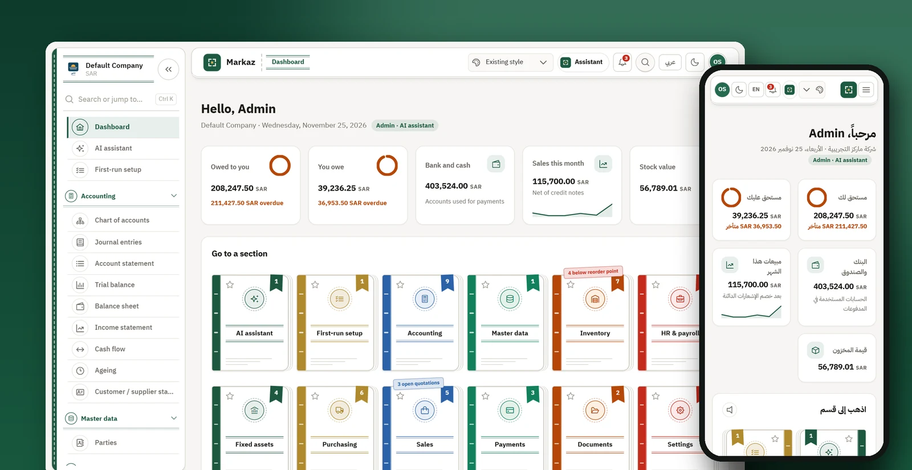

<br>

Markaz is a complete commercial accounting and ERP system built for how businesses in Saudi Arabia and the
Gulf actually work: **Arabic and English from day one**, right-to-left and left-to-right, **ZATCA
e-invoicing built in**, and a general ledger that the **database itself keeps balanced**.

It's sold as a **one-time purchase** and deployed **in isolation for every customer** — their own database,
their own server, on their own hardware or cloud account.

---

## ✦ Why Markaz

<table>
<tr>
<td width="33%" valign="top">

### ⚖️ Books that can't lie
Every journal entry is balanced **by a database trigger**, posted history is **append-only**, and money is
exact decimal — never floating point.

</td>
<td width="33%" valign="top">

### 📜 ZATCA-ready
Signed UBL 2.1 XML, cryptographic QR, clearance and reporting, submission history — in an isolated
compliance pack.

</td>
<td width="33%" valign="top">

### 🌍 Truly bilingual
Every screen, PDF, email and error in **Arabic and English**, with full RTL/LTR mirroring, dark mode and
mobile.

</td>
</tr>
<tr>
<td valign="top">

### ✨ AI that asks first
Ask questions in plain Arabic or English. The assistant prepares invoices, vouchers and entries as
**cards you approve** — never behind your back.

</td>
<td valign="top">

### 🔗 Everything connected
Quotation → order → delivery → invoice → receipt. Every document is linked, traced and posted to the ledger
automatically.

</td>
<td valign="top">

### 🔐 Secure by default
Deny-by-default permissions, an audit log the app can't rewrite, encrypted keys, refresh-token rotation.

</td>
</tr>
</table>

---

## ✦ Feature tour

> Each section is a short overview. Follow **Read the full guide →** for the detailed wiki page.

### 📒 Accounting & general ledger

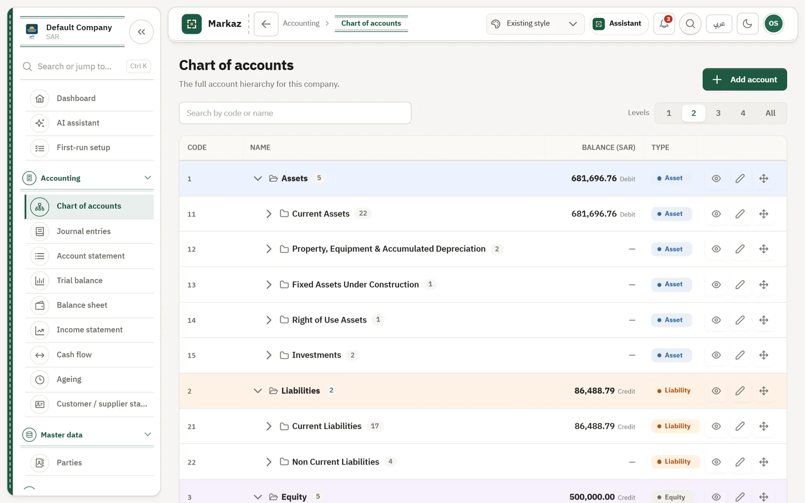

Multi-level chart of accounts with live balances, manual journal entries with cost centers and attachments,
one-click reversals, fiscal years and periods, and configurable account mapping. Trial balance, balance
sheet, income statement, cash flow and account statement — print, PDF or CSV.

**[Read the full guide →](docs/wiki/Accounting.md)**

### 🧾 Sales & receivables

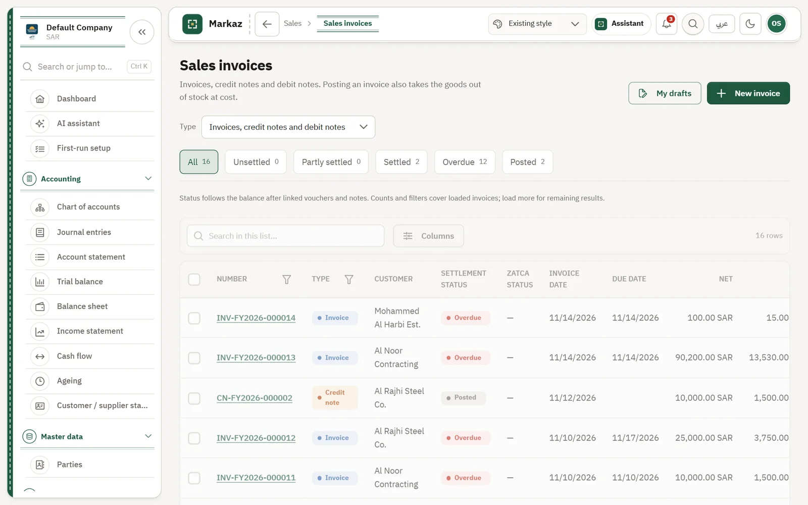

Quotations you can email as a branded PDF, sales orders, delivery notes, invoices, credit and debit notes,
and quantity returns linked to the original invoice. Each invoice shows its settlement status and
outstanding balance; posting handles revenue, VAT, receivables and cost of goods sold in one transaction.

**[Read the full guide →](docs/wiki/Sales-and-Receivables.md)**

### 🛒 Purchasing

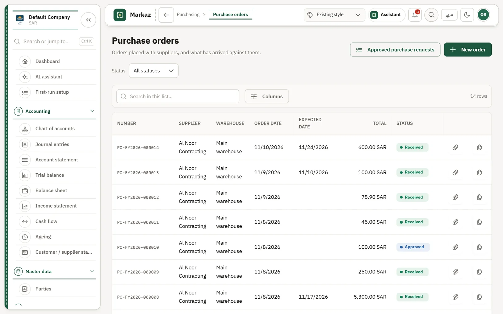

Purchase requests with review and an approval policy, purchase orders started from approved requests,
receiving into warehouses, supplier invoices with three-way matching, invoice-based purchase returns and
tax codes.

**[Read the full guide →](docs/wiki/Purchasing.md)**

### 📦 Inventory

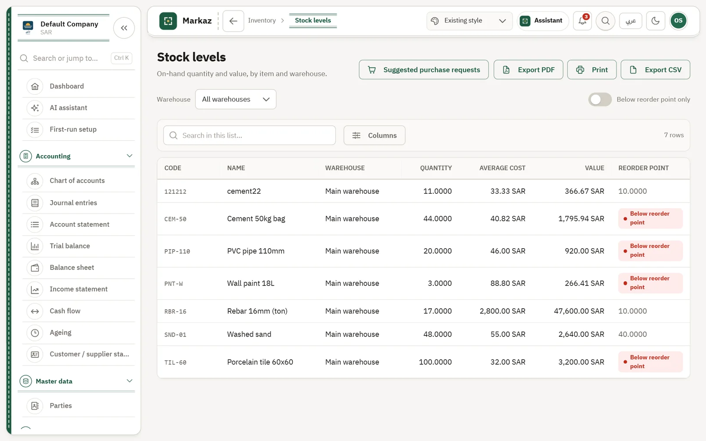

Items with pictures and reorder points, multiple warehouses, weighted-average costing, stock movements,
goods receipts, stock issues and stock counts. Replenishment suggestions turn low stock into reviewable
purchase requests.

**[Read the full guide →](docs/wiki/Inventory.md)**

### 💳 Payments, cash & expenses

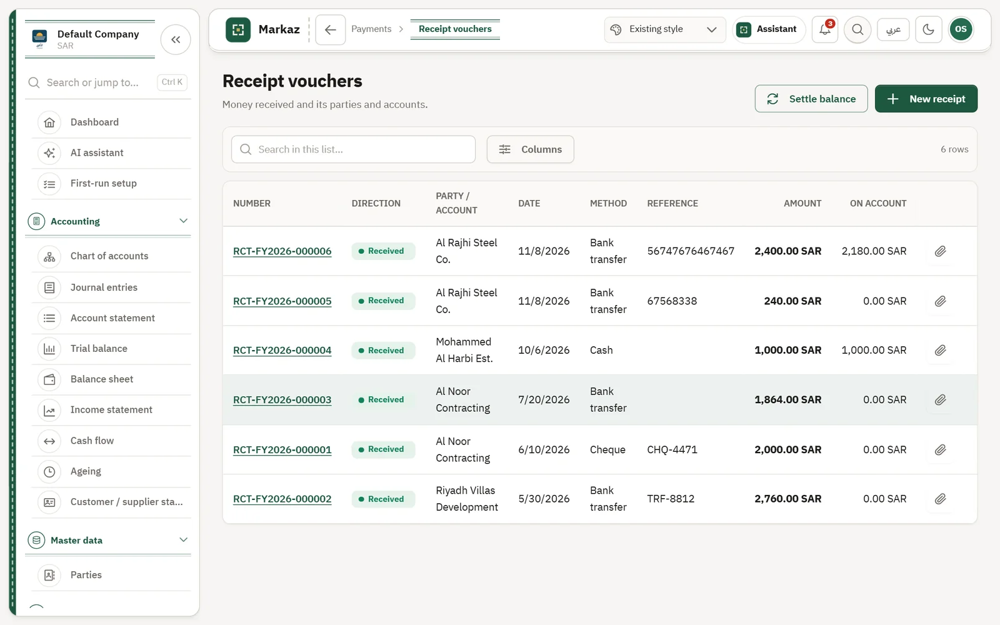

Receipt and payment vouchers for customers, suppliers, employees or any account, with "Settle now" invoice
allocation. Multi-line cash expenses with cost centers, ageing reports and customer/supplier statements.

**[Read the full guide →](docs/wiki/Payments-and-Cash.md)**

### 👥 HR & payroll

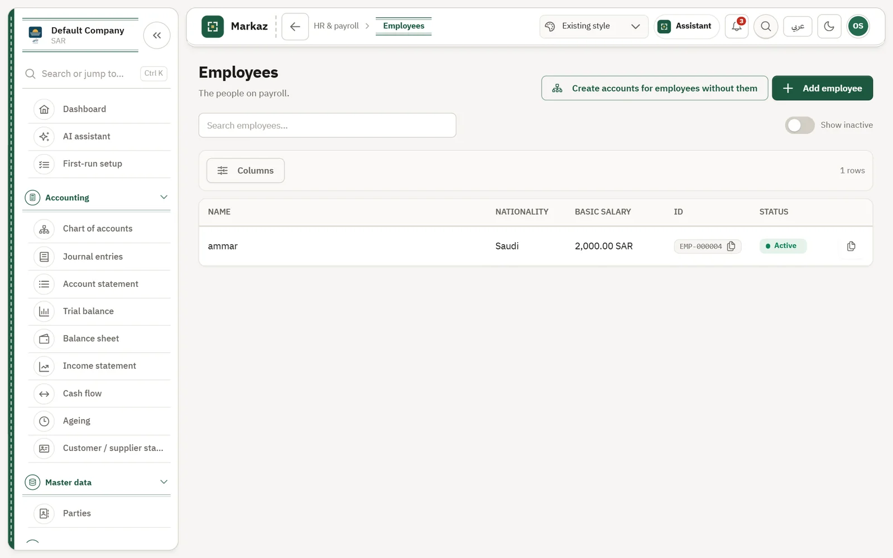

Employees and allowance types, payroll runs posted straight to the ledger, GOSI, the WPS bank salary file,
salary advances with repayment, and end-of-service settlements.

**[Read the full guide →](docs/wiki/HR-and-Payroll.md)**

### 🏢 Fixed assets

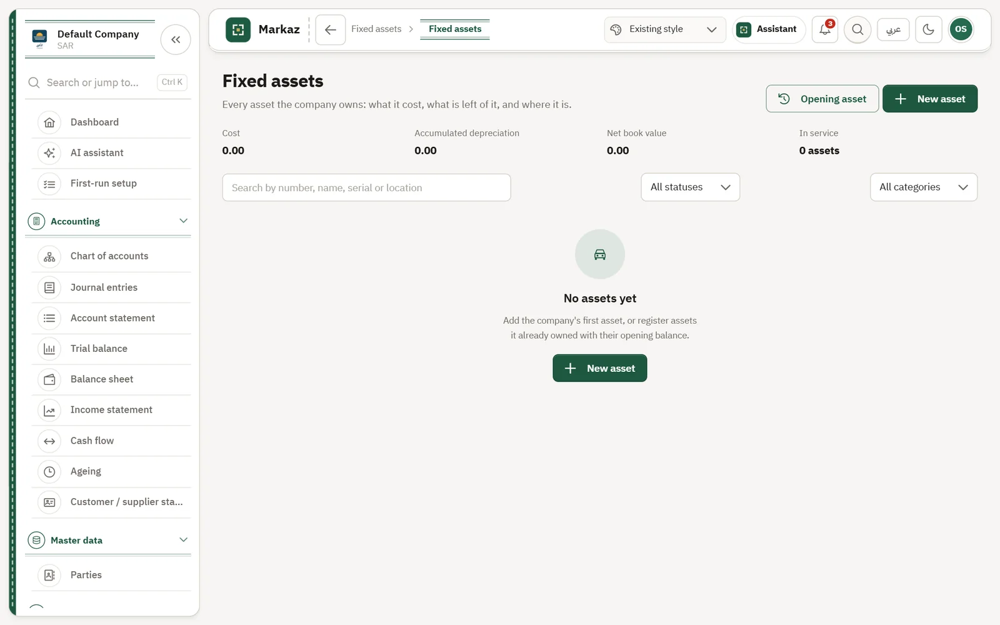

Asset categories, a full register (capitalise, opening assets, transfer), monthly straight-line depreciation
runs with preview and reversal, disposals, and reports reconciled to the ledger.

**[Read the full guide →](docs/wiki/Fixed-Assets.md)**

### 📜 ZATCA e-invoicing

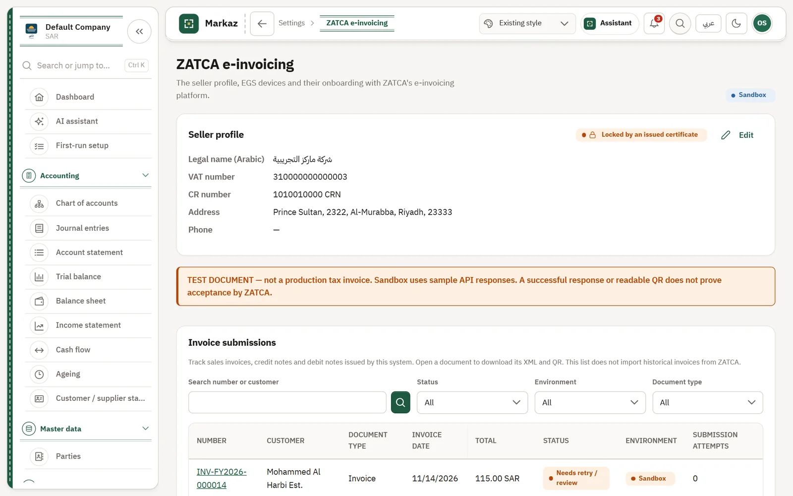

Seller profile, EGS onboarding with CSR and CSIDs, signed UBL 2.1 XML for all six document types, QR codes,
clearance and reporting, retries and a complete submission history. Keys are encrypted and never leave the
server.

**[Read the full guide →](docs/wiki/ZATCA-E-Invoicing.md)**

### ✨ AI assistant & MCP

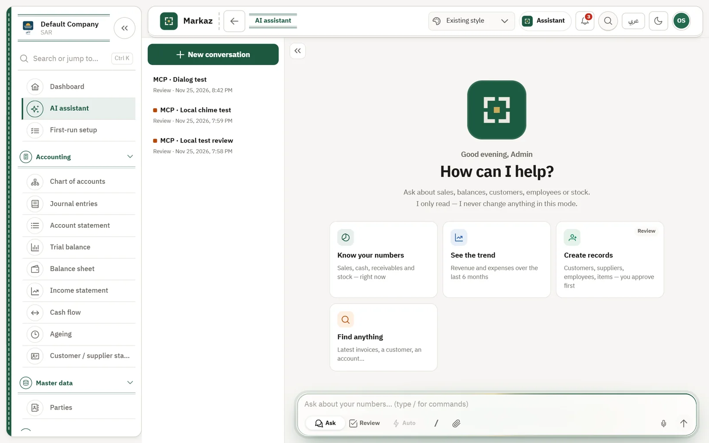

Ask about balances, sales or stock; find any document; let the assistant prepare records as editable
approval cards. Ask, Review and Auto modes, voice input, your choice of AI provider — and an MCP server so
Claude, Cursor or VS Code can work with your books through scoped tokens.

**[Read the full guide →](docs/wiki/AI-Assistant.md)**

### 💬 Chat bots

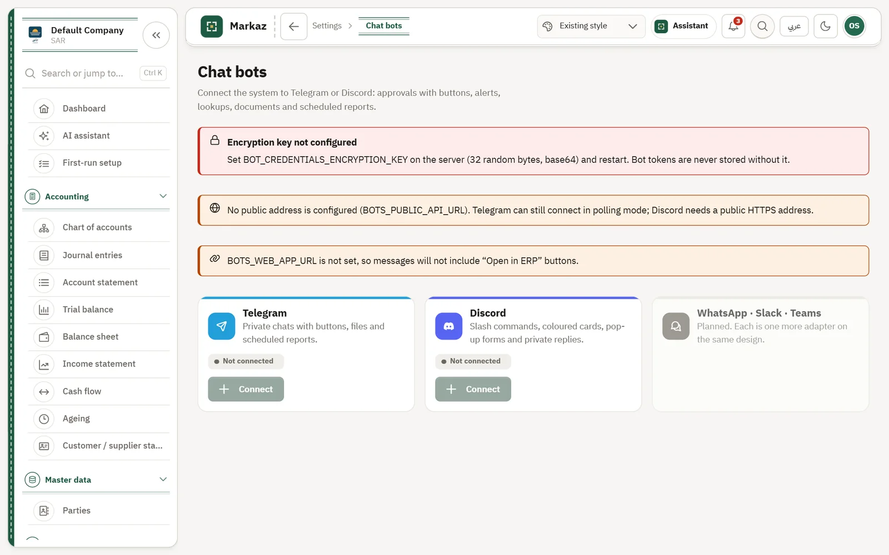

Connect Telegram or Discord for approvals, lookups, documents and scheduled reports in chat — every action
as a linked user, with permissions re-checked on every tap.

**[Read the full guide →](docs/wiki/Chat-Bots.md)**

### 📎 Documents, reports & platform

| | |
|---|---|
| **Drafts & attachments** | Autosaved private drafts, scanned documents on every record, document trail and activity — [guide](docs/wiki/Documents-and-Workflow.md) |
| **Reports & dashboard** | Live KPIs, financial statements, ageing, stock and asset reports with PDF/CSV export — [guide](docs/wiki/Reports-and-Dashboard.md) |
| **Security & admin** | Users, roles, permissions, append-only audit log, first-run setup — [guide](docs/wiki/Security-and-Administration.md) |
| **Interface** | Three design styles, palettes, dark mode, `Ctrl K` search, mobile, installable PWA, offline read-only — [guide](docs/wiki/Interface-and-Localization.md) |

---

## ✦ One product, two languages

<table>
<tr>
<td width="50%">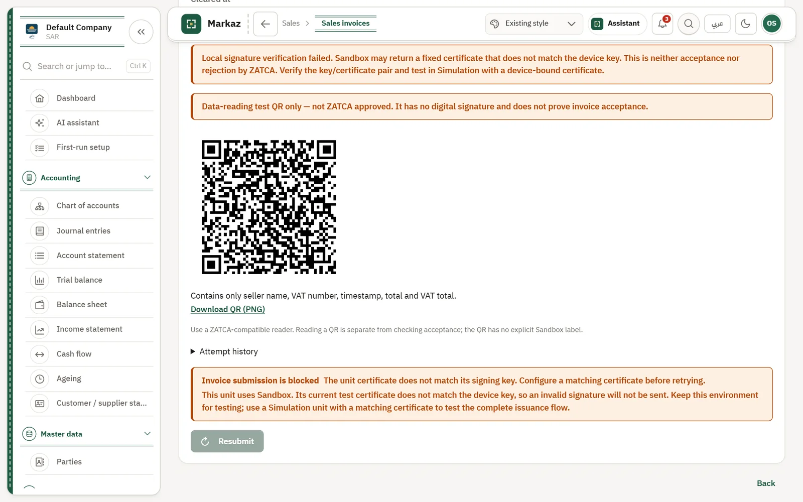</td>
<td width="50%">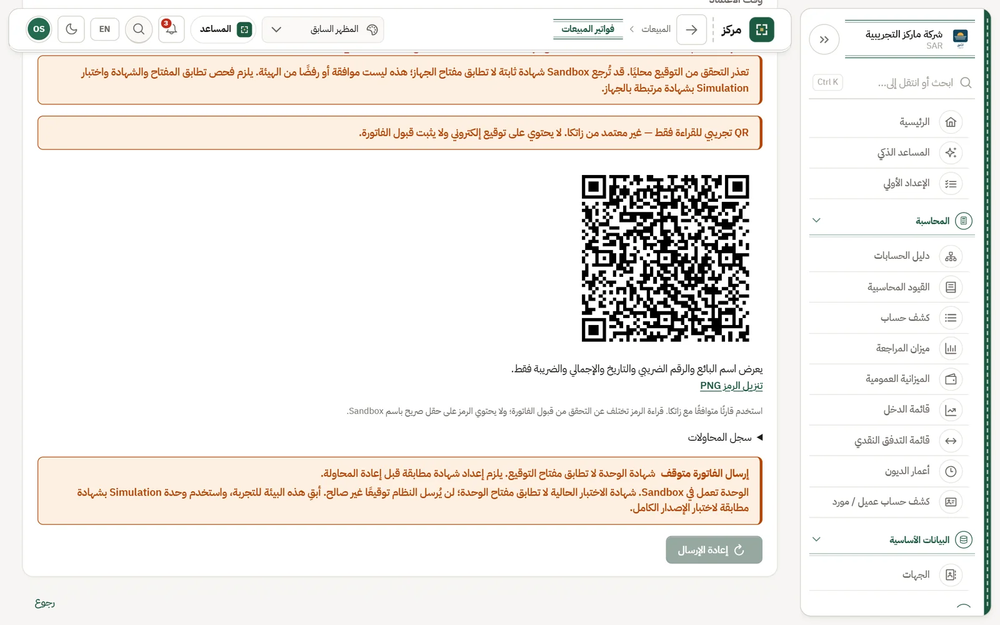</td>
</tr>
<tr>
<td>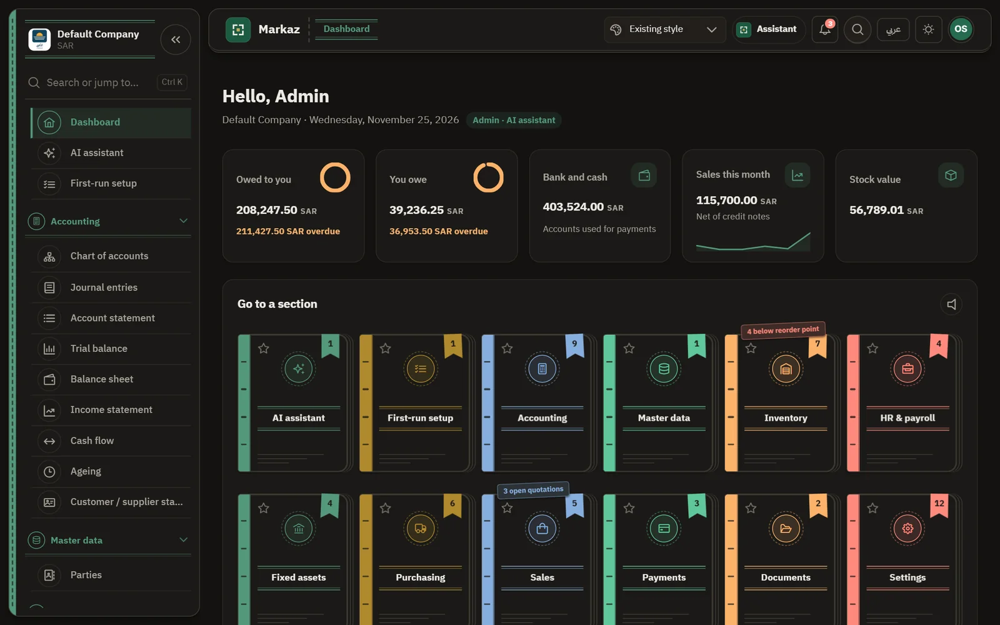</td>
<td>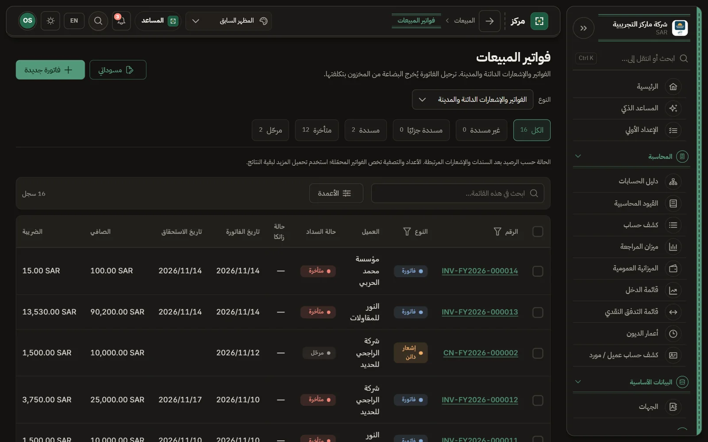</td>
</tr>
</table>

---

## ✦ Engineered like a system of record

| Guarantee | How |
|---|---|
| **Balanced ledger** | Deferred constraint trigger checks debits = credits (transaction *and* base currency) at commit |
| **Closed periods** | A trigger rejects postings into a closed fiscal period |
| **Immutable history** | Journals and audit log written through a Postgres role with no `UPDATE`/`DELETE` grant |
| **Exact money** | `Decimal(19,4)` + a `Money` value object with half-up rounding per currency ([ADR 0003](docs/adr/0003-money-representation-and-rounding.md)) |
| **No gaps, no duplicates** | Gapless transactional numbering, idempotency and submission keys |
| **Reliable side effects** | Transactional outbox and BullMQ workers on Redis |
| **Enforced boundaries** | CI runs lint, dependency-cruiser module rules, typecheck, build, tests, AR/EN key parity and an audit |
| **Tested where it matters** | Property-based tests against a real PostgreSQL assert the trial balance always nets to zero |

**[Architecture & data integrity →](docs/wiki/Architecture.md)**

---

## ✦ Tech stack

<div align="center">


</div>

```
apps/        api (NestJS) · web (React PWA) · print-agent (reserved)
packages/    core · shared · db · compliance (contract + zatca-sa) · ai · bots
docs/        product brief, rules, ADRs, release runbooks, wiki
```

---

## ✦ Quick start

```bash
cp .env.example .env                          # fill in your own values
npm install
docker compose up -d db redis
npm run migrate:deploy --workspace=@erp/db    # migrations are explicit, never automatic
npm run seed --workspace=@erp/db
npm run dev                                   # web → http://localhost:5173 · api → http://localhost:3000
```

Full setup, environment variables and production deployment: **[Getting started →](docs/wiki/Getting-Started.md)**

---

## ✦ Roadmap

| Milestone | Status |
|---|---|
| M0 Foundation · M1 Identity · M2 Accounting core · M3 Platform services | ✅ Done |
| M4 Inventory · M5 Purchasing · M6 Sales & AR | ✅ Done |
| HR & payroll · Fixed assets · AI assistant · Chat bots | ✅ Built |
| M7 ZATCA e-invoicing | 🟡 Built and sandbox-verified; live onboarding needs the taxpayer's portal access |
| M9 Frontend completion | 🟡 In progress |
| M8 Licensing & activation · M10 Hardening | ⏳ Next |

Full plan: [`docs/14-MILESTONES.md`](docs/14-MILESTONES.md) · Changes: [`CHANGELOG.md`](CHANGELOG.md)

---

## ✦ Documentation

| | |
|---|---|
| 📚 **[Wiki](docs/wiki/Home.md)** | Detailed guide to every feature |
| 📐 **[Rules pack](docs/)** | Product brief, architecture, multi-tenancy, data model, accounting, compliance, API, i18n, security, testing |
| 🧭 **[Decisions](docs/adr/)** | Architecture decision records |
| ❓ **[Open decisions](docs/01-OPEN-DECISIONS.md)** | What is still being decided |

---

<div align="center">

Built by **[Osama Othman](https://os4ma.me)** — Full-Stack Software Engineer, Riyadh.

<sub>Screenshots show a demo company with sample data.</sub>

</div>
