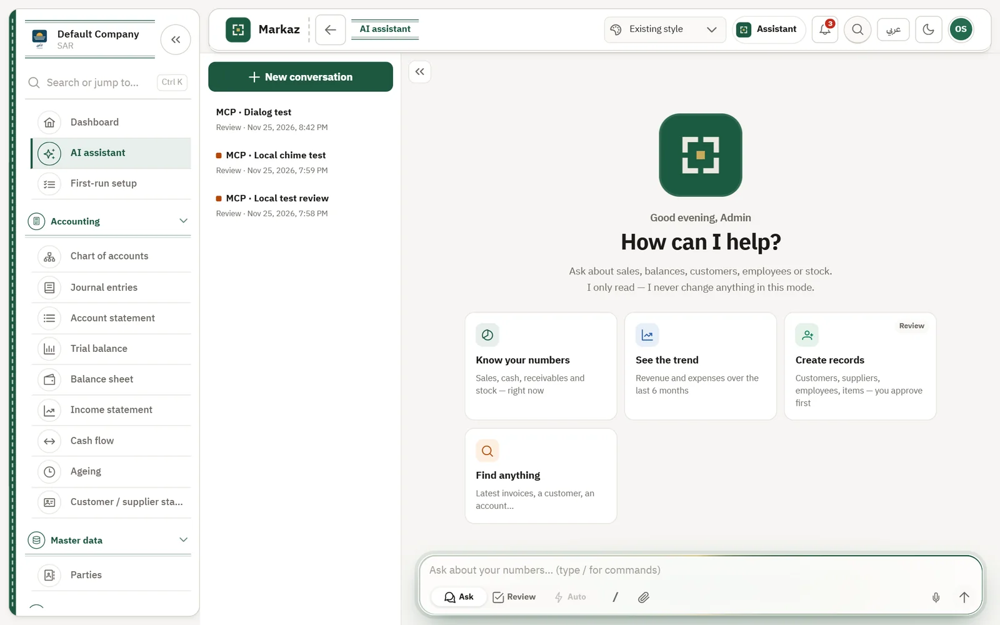
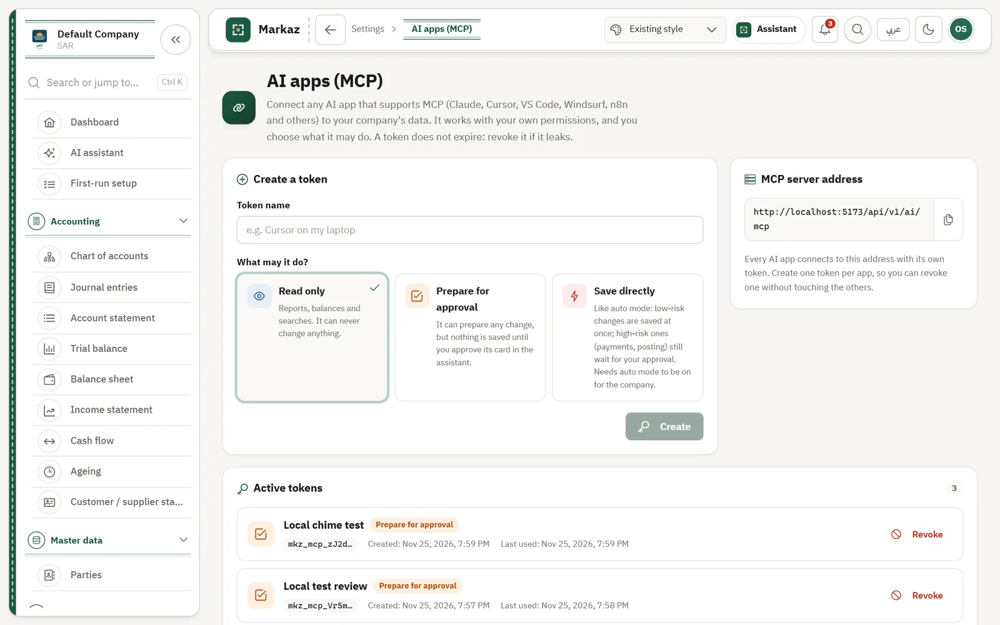

# ✨ AI Assistant & MCP

> **Ask your books anything — in Arabic or English.** The Markaz assistant reads your reports,
> finds any document, and prepares new records for you to approve. It acts as *you*, with *your*
> permissions, and never changes money, stock or the ledger without your explicit click.

[← Wiki home](Home.md) · [Chat bots →](Chat-Bots.md)

---

## At a glance

| Capability | What you get |
|---|---|
| **Natural-language questions** | Balances, receivables, sales trends, stock, payroll — answered from live data |
| **Find anything** | Read access to every document type: invoices, orders, vouchers, journals, assets and more |
| **29 write actions** | Quotations, orders, invoices, notes, vouchers, purchasing, stock, journals, payroll, assets |
| **Approval cards** | Every proposed change appears as an editable card you approve or skip |
| **Three modes** | Ask · Review · Auto, controlled by company settings and user permissions |
| **Voice input** | Dictate questions with a live microphone level indicator |
| **Bring your own model** | Anthropic, OpenAI, Google or a local Ollama model |
| **MCP server** | Connect Claude, Cursor, VS Code and other MCP apps with scoped tokens |

---

## Modes

| Mode | What the assistant may do |
|---|---|
| **Ask** | Read only. Write tools aren't even offered to the model. |
| **Review** | Every write becomes a **proposal card**. Nothing happens until you approve it. |
| **Auto** | Low-risk writes run immediately — only if the company switch **and** your permission allow it. Anything touching money, stock or the ledger still waits for approval. |

## Approval cards

When the assistant proposes a change — say, a sales invoice — you get a card showing exactly what will be
created. You can:

- **Approve** it — the action runs through the *same* endpoint the web page uses, with the same
  validation and permission checks.
- **Edit** any field first — the form is generated from the action's own schema and re-validated.
- **Skip** it — or ask the assistant to correct it; it withdraws the old card and proposes a new one.

A decision is claimed atomically, so a double-click can never run the same change twice. Every write
carries the conversation's correlation id into the [audit log](Security-and-Administration.md).

## Connect your AI apps (MCP)

**Settings → AI apps** turns Markaz into an **MCP server**. Create a token per app and choose what it may do:

| Token scope | Meaning |
|---|---|
| **Read only** | Reports, balances and searches |
| **Prepare for approval** | The app can propose changes; they appear in Markaz's notification bell for you to decide |
| **Save directly** | Low-risk changes save immediately; high-risk ones still wait for approval |

Tokens can be revoked at any time and show when they were last used.

## Safety by design

- **The model never touches the database.** Tools call the same services the web app calls, as the
  signed-in user, with permission checks both when the tool list is built and when the tool runs.
- **Prompt-injection hardening.** Tool results reach the model wrapped as untrusted data.
- **Secrets stay secret.** Provider API keys are sealed with AES-256-GCM, write-only in the API and
  never logged.
- **Admin switch.** An administrator can hide the assistant for the whole company.
