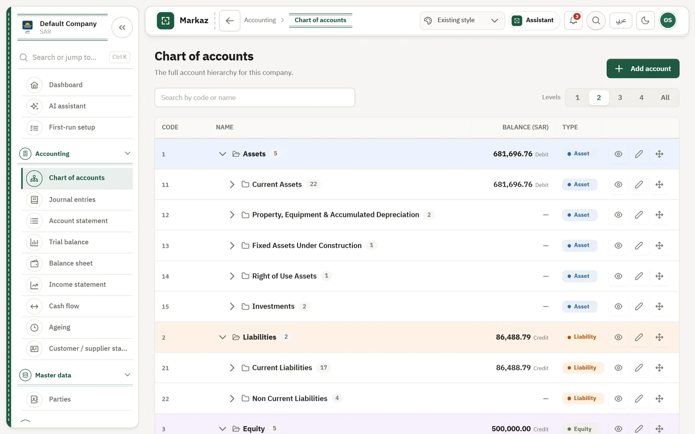
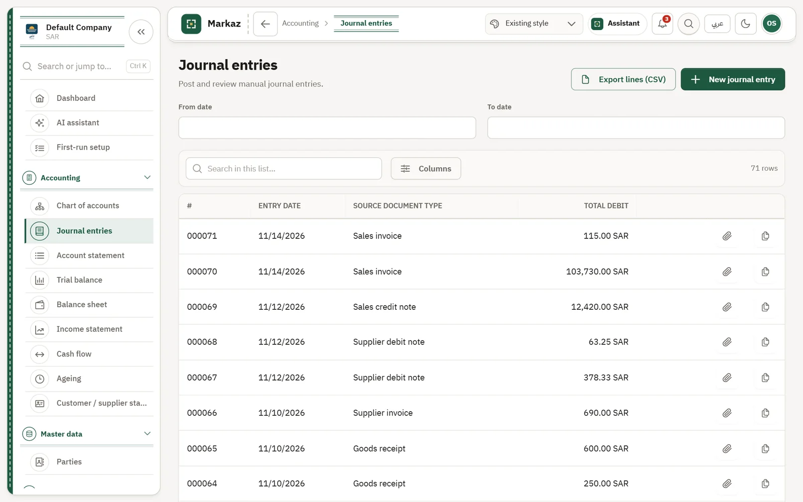
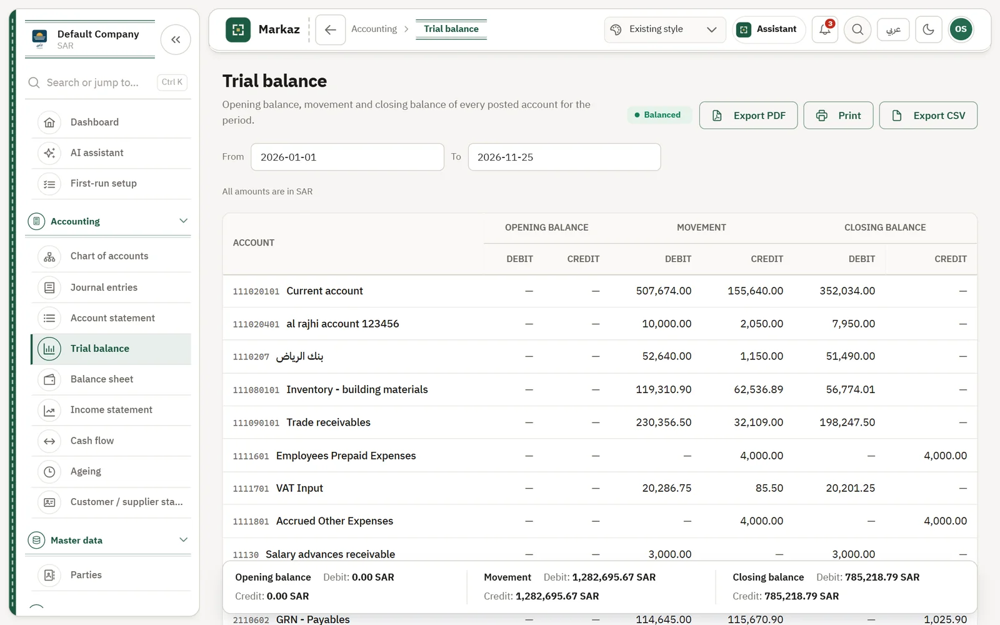

# 📒 Accounting & General Ledger

> **The ledger is the heart of Markaz.** Every invoice, receipt, stock movement, payroll run and
> depreciation run ends up here as a balanced, immutable journal entry — and the database itself
> refuses anything that doesn't add up.

[← Wiki home](Home.md) · [Reports & dashboard →](Reports-and-Dashboard.md)

---

## At a glance

| Capability | What you get |
|---|---|
| **Chart of accounts** | Multi-level tree (asset, liability, equity, revenue, expense), parent and postable accounts, colours, move/re-parent, Arabic + English names |
| **Fiscal calendar** | Fiscal years split into periods; closed periods reject new postings at the database level |
| **Journal entries** | Manual entries with any number of lines, cost centers, attachments and drafts; one-click reversal |
| **Automatic posting** | Sales, purchasing, inventory, payments, HR and fixed assets post through one engine — no module writes the ledger directly |
| **Account mapping** | Choose which accounts receive sales, VAT, stock, COGS, payroll, disposal losses and more |
| **Financial statements** | Trial balance, balance sheet, income statement, cash flow (indirect), account statement — print, PDF and CSV |
| **Multi-currency** | Every line stores the transaction amount *and* the base-currency amount; both must balance |

---

## Chart of accounts

The chart is a tree. **Parent accounts** group and total; **postable accounts** (leaves) receive
entries. Each account has a code, an English and an Arabic name, a type and an optional colour so
the tree is easy to scan.

- **Levels:** expand or collapse the whole tree to a chosen depth with the level switcher (1 – 5).
- **Live balances:** the balance column is computed from posted entries — never stored and never stale.
- **Move an account:** re-parent an account without breaking history; codes are validated against the new parent.
- **Deactivate, don't delete:** an account with history can be deactivated so it disappears from pickers
  while every past report stays exact.

## Journal entries

A journal entry is a set of debit and credit lines that **must balance** before it can be posted.

1. Open **Accounting → Journal entries → New journal entry**.
2. Add lines: account, debit *or* credit, optional description, party and cost center.
3. The footer shows the running difference; **Post** is only possible when it is zero.
4. The entry receives a gapless sequential number and becomes **immutable**.

Need to fix a mistake? Use **Reverse**. Markaz creates a mirror entry dated when you choose and links the
two. The original is never edited or deleted — that's the audit trail auditors expect.

The **Source document** column shows where each automatic entry came from (sales invoice, goods receipt,
payroll run…) and links straight to it.

## Financial statements

| Report | Notes |
|---|---|
| **Trial balance** | Opening balance, movement and closing balance per account for any date range; a "Balanced" badge confirms debits = credits |
| **Balance sheet** | Assets, liabilities and equity as of a date, grouped by the chart's hierarchy |
| **Income statement** | Revenue and expenses for a period with net income |
| **Cash flow statement** | Indirect method: operating, investing and financing activities |
| **Account statement** | Every movement on one account with a running balance |

Every report can be **printed, exported to PDF** (on your company letterhead) **or CSV**.

## Cost centers, projects & departments

Expense lines and journal lines can carry a **cost center**, **project** or **department** from a
company-wide directory. Centers are deactivated rather than deleted, so historical allocations are
preserved — including on reversals.

## Account mapping

**Settings → Account mapping** tells the posting engine which accounts to use: sales revenue, output and
input VAT, receivables, payables, inventory, cost of goods sold, salary expense, fixed-asset disposal loss,
opening-balance equity, and the folders that hold cash and bank accounts for payment vouchers. Sensible
defaults are created during first-run setup.

---

## Why you can trust the numbers

- **Balanced by the database.** A deferred constraint trigger checks `SUM(debit) = SUM(credit)` — in
  both transaction and base currency — at commit. Application bugs cannot sneak an unbalanced entry in.
- **Closed periods are closed.** A second trigger rejects posting into a closed fiscal period.
- **Append-only.** The application connects through a Postgres role that has **no `UPDATE` or `DELETE`
  grant** on journal tables. Corrections are reversals, always.
- **Exact money.** Amounts are `Decimal(19,4)` handled by a `Money` value object with half-up rounding to
  each currency's minor unit — never floating point.
- **Gapless numbering** inside the same transaction as the posting.
- **Property-based tests** fire random sequences of operations at a real PostgreSQL and assert the trial
  balance always nets to zero.

See [Architecture & data integrity](Architecture.md) for the full picture.
