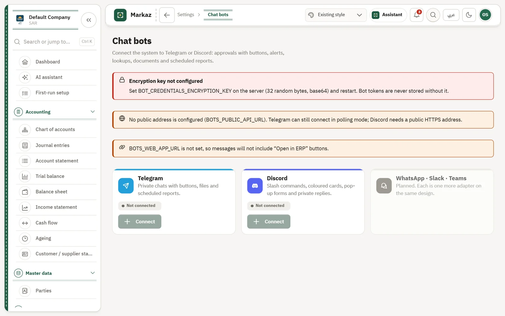

# 💬 Chat Bots

> **The ERP in the chat app your team already uses.** Telegram and Discord bots link to a real
> Markaz user, answer with the same permissions as the web app, and let approvers act on a purchase
> order without opening a browser.

[← Wiki home](Home.md) · [Documents & workflow →](Documents-and-Workflow.md)

---

## At a glance

| Capability | What you get |
|---|---|
| **Two platforms** | Telegram and Discord adapters behind one platform-neutral Bot Hub |
| **Connections** | Credentials entered in Settings, encrypted at rest and never returned by the API |
| **Account linking** | A one-time code ties a chat identity to an ERP user; no anonymous access |
| **Approvals** | Purchase-order cards with confirm and reject, using the same approval service as the web |
| **Lookups** | Customer, item, invoice and cash answers, permission-checked and read-only |
| **Alerts** | Purchase-order approvals, low stock and ZATCA problems, with per-user switches |
| **Reports** | Daily, weekly and monthly summaries delivered on a schedule |
| **Documents** | Sales invoice and customer statement PDFs, plus receipt attachments on purchases |

---

## How it fits together

A Bot Hub inside the API owns everything platform-neutral: identity links, permissions, commands,
sessions, scheduled reports and delivery. Each platform is an adapter behind one contract — Telegram
and Discord receive the same message tree and render it with the richest controls they support.

Features never build a Telegram or Discord payload. They return cards, fields, lists and buttons,
and the adapter decides how those become a message. Adding another platform means writing an
adapter, not changing every feature.

## Connecting a bot

**Settings → Chat bots** creates a connection. The credential form is generated from what the
platform adapter declares, so Telegram asks for its bot token and Discord for its application
details. A connection can be enabled, disabled or tested from the same screen.

- **Encrypted at rest:** credentials are sealed with AES-256-GCM using
  `BOT_CREDENTIALS_ENCRYPTION_KEY`. The API returns only whether a secret is set and its last four
  characters.
- **Missing key:** the settings page shows a clear notice; the rest of the application still runs.
- **Public address:** webhook mode and Discord need `BOTS_PUBLIC_API_URL`; "Open in ERP" buttons use
  `BOTS_WEB_APP_URL`.
- **HTTP-only replica:** `BOTS_RUNTIME=off` runs an API instance without bot workers.

A connection has feature switches — approvals, alerts, lookups, documents, receipts, reports — so a
company can enable only what it wants.

## Linking your account

A chat user is never anonymous. Linking starts in the web app under the user's profile:

1. Markaz creates a one-time code, stored hashed and valid for **10 minutes**.
2. The user opens the Telegram deep link or sends `/link <code>` to the Discord bot.
3. The bot links the chat identity to that ERP user and confirms.

An unlinked chat gets only a "link your account" card. A deactivated ERP user loses access on the
next message; unlinking from the web or with `/unlink` removes the link.

## Approvals

When a purchase order is waiting for approval, the bot can send a card to users who have the
approval permission. The card shows the order and its total, with buttons for the next step.

- **Confirm before acting:** approving opens a confirmation card with a single-use button.
- **Reject with a reason:** the reason is required and limited to 500 characters.
- **Same rules as the web:** the decision goes through the core approval service, so permissions,
  audit and status transitions are identical.
- **Ceiling:** a connection can set an approval ceiling; an order above it is refused in chat.
- **Permission re-check:** the approver's rights are checked again when the button is tapped, not
  only when the message was sent.

Buttons carry a random **22-character token**, bound to the user they were made for. State-changing
actions are single-use, so a double tap cannot approve twice.

## Lookups

Four read-only commands answer the everyday questions:

| Command | Answer |
|---|---|
| `/customer <name or number>` | Party reference, contact and VAT details, balance and last activity when permitted |
| `/item <name or SKU>` | Item code, reorder point and stock per warehouse when the user may read stock |
| `/invoice <number>` | Invoice status, amounts and ZATCA status, with a PDF button when documents are enabled |
| `/cash` | Cash and bank balances per account |

The same answers are available as menu buttons. Every lookup checks the caller's permission first;
an item's stock is hidden from a user without stock access rather than shown as zero.

## Alerts

Three alert types are wired:

| Alert | Trigger |
|---|---|
| `approval_requested` | A purchase order enters pending approval |
| `low_stock` | An item becomes newly below its reorder point |
| `zatca_problem` | A ZATCA record is rejected, not cleared or failed |

Users switch each type on or off in `/settings`. Quiet hours can be enabled — the default window is
**22:00–07:00** — and ZATCA problems are treated as critical, so they are delivered even during
quiet hours. An approval alert offers buttons only when the approvals feature is enabled on that
connection.

## Reports

`/report` returns today's summary immediately. A user can also subscribe to a **daily**, **weekly**
or **monthly** summary, choosing a language and a delivery time from the presets.

Summaries are permission-filtered: sales, cash, receivables, payables, stock and pending approvals
appear only for users allowed to read them. Weekly and monthly cards also show recent monthly
revenue and expense. A subscription records the period it last sent, so two replicas cannot both
deliver the same report.

## Documents and receipts

- **Documents out:** a sales invoice or customer statement can be delivered as the same PDF the web
  app produces, in the user's language. Every file sent is audited.
- **Receipts in:** a photo or PDF sent to the bot can be attached to a recent supplier invoice or
  purchase order. It goes through the same attachment service as a web upload, with the same type
  and size checks. A file never creates a financial document by itself.

## Groups and direct messages

The default is a private chat. In Telegram groups only `/chatid` and `/help` respond; approvals and
lookups stay in direct messages, where the audience is known. On Discord, replies in server channels
are ephemeral. A group or channel can be configured as a broadcast target for reports, with an
explicit data scope.

## Why you can trust it

- **A real user, every time.** Every request runs as a linked ERP user through the same permission
  service as the web; no anonymous bot access exists.
- **Credentials stay secret.** AES-256-GCM at rest, only `set` and the last four characters
  returned, and secret fields are kept out of logs.
- **Signed inbound traffic.** Telegram webhooks carry a per-connection secret compared in constant
  time; Discord interactions carry an Ed25519 signature and a timestamp window.
- **Buttons are bound and checked.** Tokens are random, tied to one user, expiring, single-use for
  state changes, and the permission is re-checked on tap.
- **Two audit trails.** The core service records the business change, and the bot adds a `bot.*`
  record with the channel. Disabling a connection stops inbound processing and outbound delivery.
- **No duplicate delivery.** Event ids are remembered, and the same inbound event is acknowledged
  and ignored rather than applied twice.

## Current limits

The bots are complete and tested end-to-end against a fake platform; a **live round trip needs your own
Telegram or Discord bot credentials**. Automated tests cover the Hub with a fake platform; they do not exercise the live
Telegram or Discord APIs.

- Adapter limits such as file sizes and component counts were written from platform documentation
  and marked for review where uncertain.
- Discord on-premise without a public HTTPS address is not supported.
- Report charts are text-only.
- Alerts cover purchase-order approvals, low stock and ZATCA problems; purchase-request reviews and
  overdue-invoice digests are not alerted yet.
- Receipts can be attached to supplier invoices and purchase orders only, and payroll data is
  excluded from bots.

See [Security & administration](Security-and-Administration.md) for users and permissions, and
[ZATCA e-invoicing](ZATCA-E-Invoicing.md) for the compliance status the alerts report.
