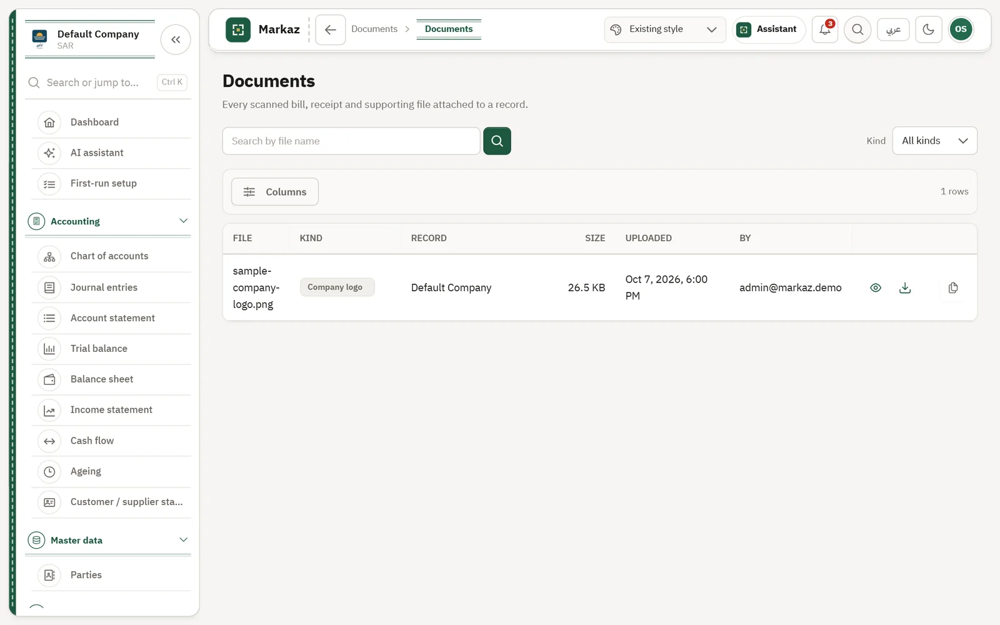

# 📎 Documents, Drafts & Workflow

> **Never lose work, never lose a paper trail.** Drafts save themselves, every scanned bill is
> attached to its record, every document links to the ones before and after it, and every PDF
> carries your letterhead.

[← Wiki home](Home.md) · [Reports & dashboard →](Reports-and-Dashboard.md)

---

## At a glance

| Capability | What you get |
|---|---|
| **Private drafts** | Autosave on every document form, conflict detection, resume from *My drafts* |
| **Safe submission** | A stable submission key per document — a double click or network retry never posts twice |
| **Attachments** | Scanned bills, receipts and contracts attached to the record they support |
| **Document trail** | Linked documents shown as cards: quotation → order → delivery → invoice → receipt |
| **Activity tab** | Who created, posted, emailed or reversed a document, from the audit log |
| **Branded PDFs** | Company letterhead and logo, page numbers, amounts in words (Arabic & English) |
| **Email** | Bilingual, branded emails with the PDF attached, via SMTP or Resend |
| **Excel / CSV import** | Items and parties imported with a coloured row-by-row preview |
| **Approvals** | Purchase-order approval policy with an amount threshold |

---

## Drafts that save themselves

Purchasing, sales, inventory, journal and payment forms autosave to a **private server draft** while you
type. Close the tab, come back tomorrow, open **Documents → My drafts** and carry on. If the same draft
was changed in another tab, Markaz detects the version conflict instead of silently overwriting it.

## Attachments

Attach supporting files to journal entries, payment vouchers, purchase orders, supplier invoices, sales
invoices and parties. The **Documents** page lists every file with its record, size, uploader and date,
with preview and download. Storage is local by default.

## Document trail & activity

Every commercial document shows:

- **Linked documents** — the documents it came from and the ones created from it, as clickable cards.
- **Activity** — a permission-checked timeline drawn from the audit log, with full details on demand.

## Printing, PDF & email

All PDFs render through one company-document service:

- Company letterhead and logo, buyer / supplier details from the party record — missing tax or address
  details are never invented.
- Page numbers and the document reference on every page, repeated footers, correct pagination.
- **Amounts in words** (tafqeet) in Arabic, or English when requested.
- Arabic and English layouts with the right text direction.

Quotations and notices can be **emailed** with a single accent-coloured, inline-styled template that
respects the reader's language direction. Send attempts are stored, so delivery can be checked and
resent deliberately.

## Import from Excel or CSV

Import **items** and **parties** from XLSX or CSV. Markaz previews every row — ready rows green, duplicates
amber, errors red — and you either fix the file or explicitly choose **Import valid rows only**. The commit
revalidates in a single transaction with an audit record, and never overwrites an existing record.

## Feedback you can trust

A shared toast host reports the outcome of every operation, survives navigation, and distinguishes
partial results in bulk actions.

See [Security & administration](Security-and-Administration.md) for the audit log itself.
