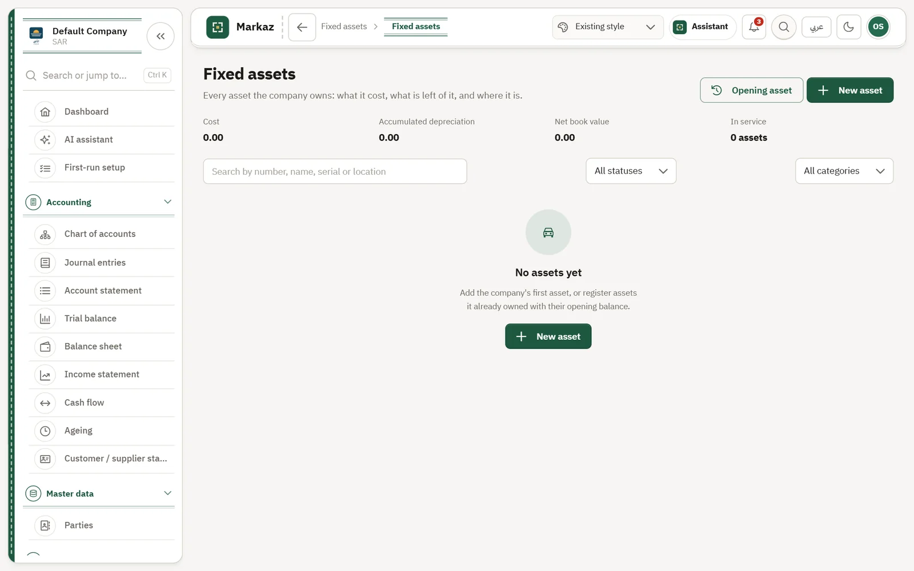

# 🏢 Fixed Assets & Depreciation

> **Buy it once, write it down day by day, and retire it with a clear entry.** Markaz keeps a
> register that reconciles to the ledger, depreciates every asset by the calendar day, and makes
> disposal the only way an asset leaves the books.

[← Wiki home](Home.md) · [Chat bots →](Chat-Bots.md)

---

## At a glance

| Capability | What you get |
|---|---|
| **Categories** | Default life, residual percentage, number prefix and the three ledger accounts |
| **Asset register** | Cost, dates, supplier, custodian, location, serial, barcode and cost centre |
| **Capitalisation** | Dr the asset account / Cr the bank, cash or supplier account it was paid from |
| **Opening assets** | Cost, depreciation already taken and book value brought in on the opening date |
| **Transfers** | Move location, custodian or cost centre without touching the ledger |
| **Depreciation runs** | One straight-line run per month, one line pair per asset, reversible only when latest |
| **Disposals** | Scrap, loss or write-off with depreciation brought up to the disposal day |
| **Reports** | Register as of a date, movement and ledger reconciliation, with PDF and CSV export |

---

## Categories

A category supplies what every asset in it needs by default: a **number prefix**, a **default useful
life**, a **default residual percentage** and three accounts — asset, accumulated depreciation and
depreciation expense.

- A **non-depreciable** category such as land carries no life and no depreciation accounts, and a
  residual value is a percentage of cost unless the asset overrides it.
- Once any asset in a category has been posted, its **accounts and prefix are frozen**. Changing them
  would leave the register and the ledger telling two different stories.
- A category no longer used is deactivated rather than deleted.

## The register

An asset starts as a **draft** — a form being filled in, with a number from its category's prefix.
A draft can be edited or deleted; capitalising it posts the cost and moves it to **ACTIVE**, after
which its money fields never change.

| Status | Meaning |
|---|---|
| **DRAFT** | Not yet in the ledger |
| **ACTIVE** | In service and depreciating |
| **FULLY_DEPRECIATED** | Book value has reached the residual value |
| **DISPOSED** | Removed through a disposal document |

Descriptive fields — name, description, supplier, serial number and barcode — can still be corrected
after capitalisation. Location, custodian and cost centre change through a **transfer**, not an edit.

## Capitalising an asset

**Fixed assets → Register → Capitalise** posts:

- **Dr** the category's asset account at the acquisition cost;
- **Cr** the active postable account the asset was paid from — bank, cash, a supplier account or
  assets under construction.

The amount is the **net cost**. A purchase carrying VAT goes through a supplier invoice instead, so
input VAT is recorded in one place. The acquisition date must have an open fiscal period, and the
in-service date cannot precede it.

## Opening assets

An asset the company already owned is registered with its **opening accumulated depreciation** and
the date it is stated at: **Dr** the asset account at cost, **Cr** accumulated depreciation for what
was already taken, and **Cr** opening-balance equity for the remaining book value. Depreciation then
resumes the next day and spreads the remaining amount over the days left of the original life.

## Bought on a supplier invoice

A supplier invoice line can be a **fixed-asset line** with a category. That line debits the
category's asset account, and Markaz registers the asset in the same transaction, in service from
the invoice date. A line with quantity above one becomes one asset at its total cost.

## Transfers

A transfer records a new location, custodian or cost centre, with a date and optional reason. It
posts nothing: the asset's cost and accumulated depreciation do not move. Depreciation from the next
run onward is charged to the new cost centre, and the transfer history is append-only.

## Depreciation

Depreciation is **straight-line, pro-rated by the calendar day**. Every calculation asks how much
should have been taken in total by the end of a date, rounds that cumulative figure once, and takes
the difference from what was already posted. The last day of the useful life therefore lands the
book value exactly on the residual value, with no accumulated rounding drift.

**Fixed assets → Depreciation → New run** previews a month before anything is posted. Posting then
writes **one balanced entry dated the last day of the month**, with one line pair per asset:

- **Dr** the category's depreciation expense;
- **Cr** the category's accumulated depreciation;
- the asset's **cost centre** on the debit line, where it has one.

An asset brought into service late is caught up in the next run, and those lines are flagged as
catch-up. A past entry is never rewritten to include it.

## Run rules

- **One run per month**, for the whole register. A month that has already been depreciated cannot be
  run again, and a later month cannot be posted before an earlier one.
- **No future months.** A month that has not started yet cannot be depreciated.
- **The latest run only can be reversed.** The reversal is a mirror entry dated the same day as the
  run, so the month nets to zero, and every asset returns to where the run found it.
- **A disposal blocks reversal.** If an asset in the run has since been disposed of, the run can no
  longer be cleanly undone.
- **A closed month cannot be reversed**, and an open fiscal period must cover the run date.

## Disposal

**Fixed assets → Register → Dispose** takes an asset off the books as **SCRAP**, **LOSS** or
**WRITE_OFF**, with a date and reason.

1. Depreciation is first brought up to the disposal day itself, pro-rated by the day.
2. Accumulated depreciation and the asset's cost leave the ledger.
3. Whatever book value remains is a **loss on disposal**.

The entry is **Dr** depreciation expense for the final days, **Dr** accumulated depreciation for
all of it, **Dr** loss on disposal for the book value left, and **Cr** the asset account at cost.
The disposal is numbered in the **FAD** series.

A disposal cannot predate the day the asset entered the ledger. If depreciation has already been
posted past the chosen date, reverse that run first or choose a later disposal date. Selling an
asset to a customer is not a disposal here; it needs a tax invoice and is outside this workflow.

## Reports

| Report | What it shows |
|---|---|
| **Register as of a date** | Every asset in the register, its cost, accumulated depreciation and book value at that date |
| **Movement** | Opening balance, additions, depreciation and disposals for a period |
| **Ledger reconciliation** | Register totals against the asset and accumulated-depreciation accounts, with a reconciled flag |

Reports read the register's own dated documents, so an "as of" figure matches the general ledger at
the same date. The reconciliation report compares the two directly and shows any difference — for
example, a manual journal posted to an asset account outside this module.

## Why you can trust it

- **Day-exact, not month-averaged.** The cumulative target is rounded once and differences are taken
  from it, so the final day lands exactly on residual value.
- **One run, one entry.** The whole register posts in a single balanced journal, and the run cannot
  interleave with a disposal.
- **Posted money is frozen.** Cost, residual and life are fixed after capitalisation; corrections
  are transfers, disposals or a reversing run, never an edit.
- **The register reconciles.** Reported book value is built from dated capitalisations, runs and
  disposals, and the reconciliation report proves it against the ledger.
- **Category rules are locked.** Once an asset is posted, its category's accounts and prefix cannot
  change, so history cannot be repointed to different accounts.
- **Bought or built, one transaction.** A fixed-asset line on a supplier invoice debits the asset
  account and registers the asset together, or neither happens.

See [Chat bots](Chat-Bots.md) for the next page and [Accounting](Accounting.md) for the ledger that
receives every entry.
