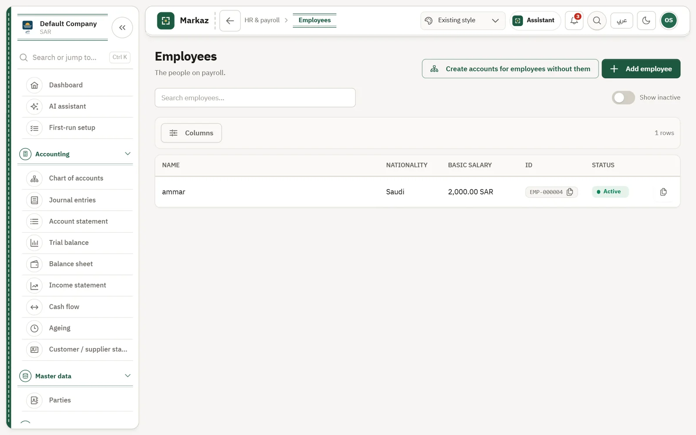
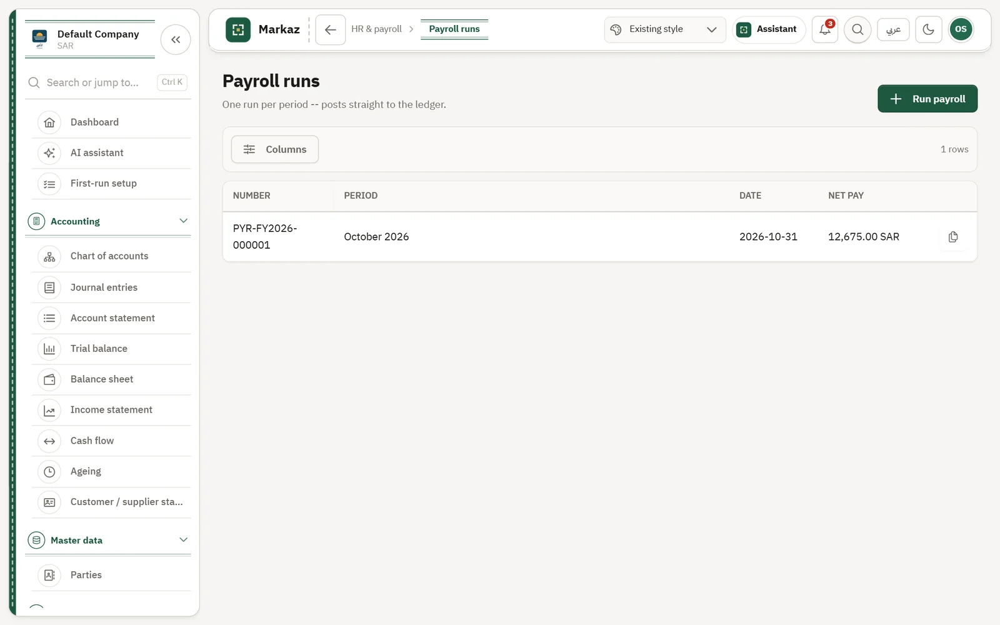

# 👥 HR & Payroll

> **One roster, one monthly run, one balanced entry.** Markaz keeps each employee's salary
> structure, computes GOSI and end-of-service from explicit rules, recovers advances automatically,
> and posts payroll to the ledger as a single auditable journal entry.

[← Wiki home](Home.md) · [Fixed assets →](Fixed-Assets.md)

---

## At a glance

| Capability | What you get |
|---|---|
| **Employees** | Reference, bilingual name, national ID, Saudi status, IBAN, hire date, salary and allowances |
| **Allowance types** | Reusable types with flags for the GOSI base and the end-of-service base |
| **Payroll runs** | One run per year and month, with GOSI, advance recovery and net pay in one entry |
| **GOSI** | Pension, occupational-hazard and SANED contributions from the configured rates |
| **WPS file** | A bank-ready, tab-separated SAR wages file with a header and one line per employee |
| **Salary advances** | Granted against future salary, recovered in installments by each payroll run |
| **End of service** | Gratuity computed from service and reason, accrued, then paid as a separate event |
| **HR payments** | Salary, GOSI and end-of-service payments posted against the liabilities they clear |

---

## Employees

The employee record is the master data for payroll, the WPS file and end-of-service. It carries:

- a company **reference**, bilingual **name**, **national ID**, **Saudi status**, an IBAN with an
  optional bank name, **hire date**, optional termination date and an active flag;
- **basic salary** and a set of **allowances** by type.

An employee can also carry the marker for the **pre-2024 GOSI law**. That flag is set by hand,
because which employees fall under the old law is a legal judgement the system does not make. An
employee on that track is left out of a payroll run and reported separately rather than being given
a guessed rate.

If the three employee account groups are mapped, each employee also receives a party and three
ledger accounts — salary advance, salary payable and employee dues. Otherwise payroll uses the
company-wide accounts; a half-configured mapping is refused.

## Allowances

An allowance type has a code, bilingual names and three flags: **housing**, **in GOSI base** and
**in end-of-service base**. The code and the housing flag never change after creation, because the
housing flag decides which WPS column an amount is reported in.

New types default to not in the GOSI base and in the end-of-service base; the company can change
the two base flags. Common allowances can be added in one click, but never silently.

## Payroll runs

A payroll run is identified by **year and month**, and there can be only one run for a period. It
includes active employees hired on or before the run date, computes every line, and posts one
**PYR**-numbered entry.

Each employee line holds basic salary, housing and other allowances, gross, the employee and
employer GOSI shares, any advance deduction and net pay. The ledger entry is aggregated across the
run, not one pair per employee:

| Entry | Amount |
|---|---|
| **Dr Salary expense** | Sum of gross salaries |
| **Dr GOSI employer expense** | Sum of employer shares |
| **Cr GOSI payable** | Employee plus employer shares |
| **Cr Salary advances receivable** | Advance installments recovered, when any |
| **Cr Net pay payable** | Sum of net pay |

Per-employee detail stays on the run lines, so every figure traces to a person, while net pay is
credited to the employee's own salary-payable account when one exists or to the company-wide one.

## GOSI

The contribution base is **basic salary plus the allowances flagged for the GOSI base**, capped at
**SAR 45,000 per month**. Other allowances do not enter the calculation.

As configured in the code, the contributions are:

| Component | Configured rate |
|---|---|
| **Pensions** | 18% in months 1–12, then 19%, 20% and 21% in the following 12-month steps, reaching 22% after month 48 — split equally between employer and employee |
| **Occupational hazards** | 2%, employer only |
| **SANED (unemployment)** | 2% total, 1% employer and 1% employee, Saudi employees only |

An expatriate therefore carries the employer's occupational-hazard contribution only. The run uses
the rate in effect on its run date, so the pension step is applied automatically.

## WPS wages file

The WPS export is a **tab-separated, SAR-only** file: a header line with the establishment's bank
and MOL details, one content line per employee, and a `-` line marking the end. Amounts use a comma
as the decimal separator and two decimal places. Company settings hold the bank SARIE id, bank
account number and MOL establishment id; demo, placeholder or test text is rejected, so validate the
first real file with your bank's own test tool.

## Salary advances

An advance is cash against future salary: **Dr Salary advances receivable / Cr** the bank or cash
account it was paid from. It is numbered in the **ADV** series and carries an installment amount.

- **Automatic recovery:** each payroll run deducts the oldest advance first, taking the smaller of
  the remaining balance and that advance's installment.
- **Never edited:** the remaining balance is derived from the advance, its payroll deductions and
  any direct repayments — never stored as a number someone can overwrite.
- **Direct repayment:** the employee can pay cash back (**ARP** series), posting **Dr** bank or cash
  / **Cr** advances receivable; over-repayment is refused. A leaver can still repay, which is how the
  balance is cleared before an end-of-service settlement.

## End of service

A settlement computes the gratuity, accrues it and marks the employee terminated in one transaction.
The wage base is **basic salary plus fixed allowances**, the system's reading of the "last wage".

- **Service:** whole calendar years plus the exact fraction of the current year actually worked.
- **Award:** half a month's wage per year for the first five years, a full month per year after that.
- **Resignation:** nothing under two years, one third from two to five, two thirds from five to ten,
  and the full award from ten years.
- **Other reasons:** termination and other permitted reasons are paid in full.
- **Advances first:** an employee who still owes a salary advance cannot be settled; the advance is
  repaid first.
- **Nothing owed:** the settlement is still recorded, but no journal entry is posted when the
  entitlement is zero.

The accrual is **Dr End-of-service expense / Cr End-of-service payable** and is numbered in the
**EOS** series. Paying it out is a separate payment, not part of the accrual, so the ledger records
when the obligation arose and when cash left as two distinct events.

## Paying what is owed

HR payments clear the liabilities payroll and end-of-service created:

| Payment | Debit | Credit |
|---|---|---|
| **Salary** (`SPY`) | Net pay payable, per employee account | Bank or cash |
| **GOSI** (`GPY`) | GOSI payable | Bank or cash |
| **End of service** (`EPY`) | End-of-service payable | Bank or cash |

A salary line can be paid once, GOSI can be remitted in full or in part but never above what is
owed, and a gratuity can be paid once. A payment cannot be dated before the run or settlement it
pays.

## Why you can trust it

- **Rules, not retyping.** GOSI rates, the pension step and end-of-service fractions live in code
  and are applied from dates, not copied into each run by hand.
- **One run per month.** The period is unique per company, and the roster, calculations and journal
  entry commit in one transaction.
- **Balances are derived.** Advance recovery reads the advance, its deductions and repayments under
  a lock, so two processes cannot recover the same money twice.
- **Two events, two entries.** Accruing a gratuity and paying it are separate postings; payroll and
  payment each leave their own audit trail.
- **Explicit exclusions.** Employees on the legacy GOSI track are excluded and named in the run
  result instead of being given a rate the system cannot justify.

See [Fixed assets](Fixed-Assets.md) for the next module and [Accounting](Accounting.md) for the posting engine.
