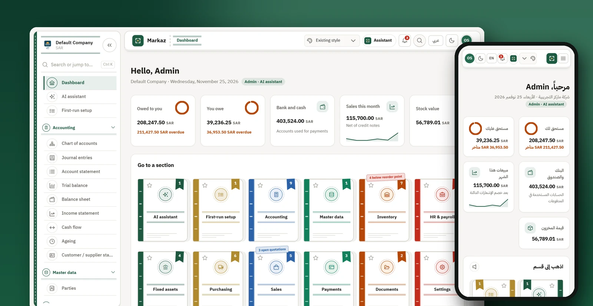

# 📚 Markaz Wiki

**The complete guide to Markaz — the Arabic-first ERP for Saudi & Gulf businesses.**

[README](../../README.md) · [Arabic README](../../README.ar.md) · [Getting started](Getting-Started.md) · [Architecture](Architecture.md)

---

## Business modules

| | Page | What's inside |
|---|---|---|
| 📒 | [**Accounting & general ledger**](Accounting.md) | Chart of accounts, journals, reversals, fiscal periods, account mapping, cost centers, financial statements |
| 🧾 | [**Sales & receivables**](Sales-and-Receivables.md) | Quotations (with email), orders, delivery notes, invoices, returns, credit/debit notes, settlement status |
| 🛒 | [**Purchasing**](Purchasing.md) | Requests, approvals, orders, receiving, supplier invoices with three-way matching, returns |
| 📦 | [**Inventory**](Inventory.md) | Items, warehouses, stock levels, movements, receipts, issues, counts, replenishment |
| 💳 | [**Payments, cash & expenses**](Payments-and-Cash.md) | Receipt/payment vouchers, invoice settlement, cash expenses, ageing, statements |
| 👥 | [**HR & payroll**](HR-and-Payroll.md) | Employees, allowances, payroll runs, GOSI, WPS file, salary advances, end of service |
| 🏢 | [**Fixed assets**](Fixed-Assets.md) | Categories, register, depreciation runs, transfers, disposals, reports |

## Compliance & intelligence

| | Page | What's inside |
|---|---|---|
| 📜 | [**ZATCA e-invoicing**](ZATCA-E-Invoicing.md) | EGS onboarding, signed UBL XML, QR, clearance & reporting, submission history |
| ✨ | [**AI assistant & MCP**](AI-Assistant.md) | Natural-language questions, approval cards, Ask/Review/Auto, MCP tokens for Claude & co. |
| 💬 | [**Chat bots**](Chat-Bots.md) | Telegram & Discord: approvals, lookups, documents and reports in chat |

## Platform

| | Page | What's inside |
|---|---|---|
| 📎 | [**Documents, drafts & workflow**](Documents-and-Workflow.md) | Autosaved drafts, attachments, document trail, PDFs, email, Excel import |
| 📊 | [**Reports & dashboard**](Reports-and-Dashboard.md) | Live dashboard and every financial report, with PDF/CSV export |
| 🔐 | [**Security & administration**](Security-and-Administration.md) | Users, roles, permissions, audit log, encryption, first-run setup |
| 🌍 | [**Interface, Arabic & English**](Interface-and-Localization.md) | RTL/LTR, three design styles, dark mode, mobile, PWA, offline |

## For engineers

| | Page | What's inside |
|---|---|---|
| 🏛️ | [**Architecture & data integrity**](Architecture.md) | Stack, modules, Core contracts, database-enforced guarantees, ADRs |
| 🚀 | [**Getting started**](Getting-Started.md) | Configure, migrate, seed, run, deploy |

---

Screenshots are taken from a demo company in the local development environment. Names, figures and
e-mail addresses are sample data.
