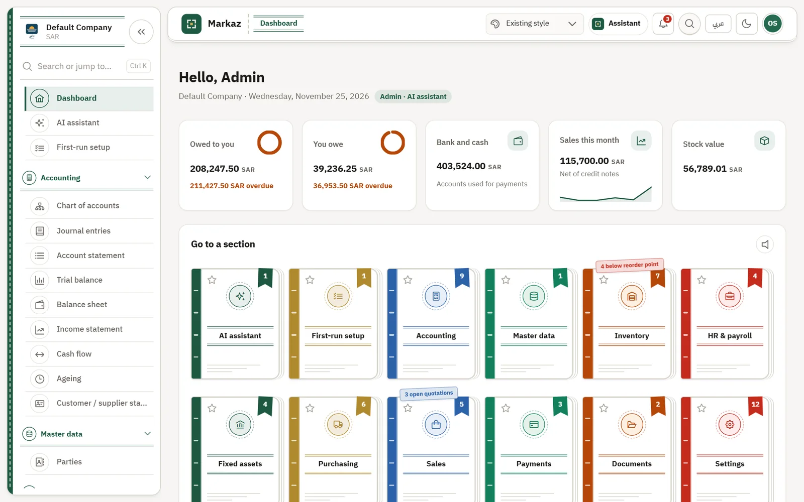
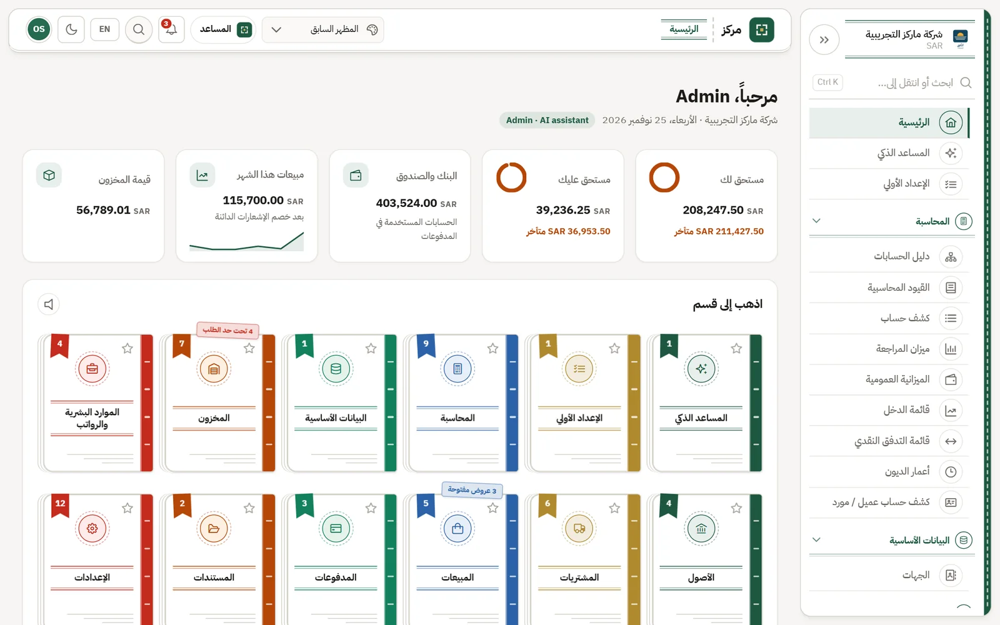
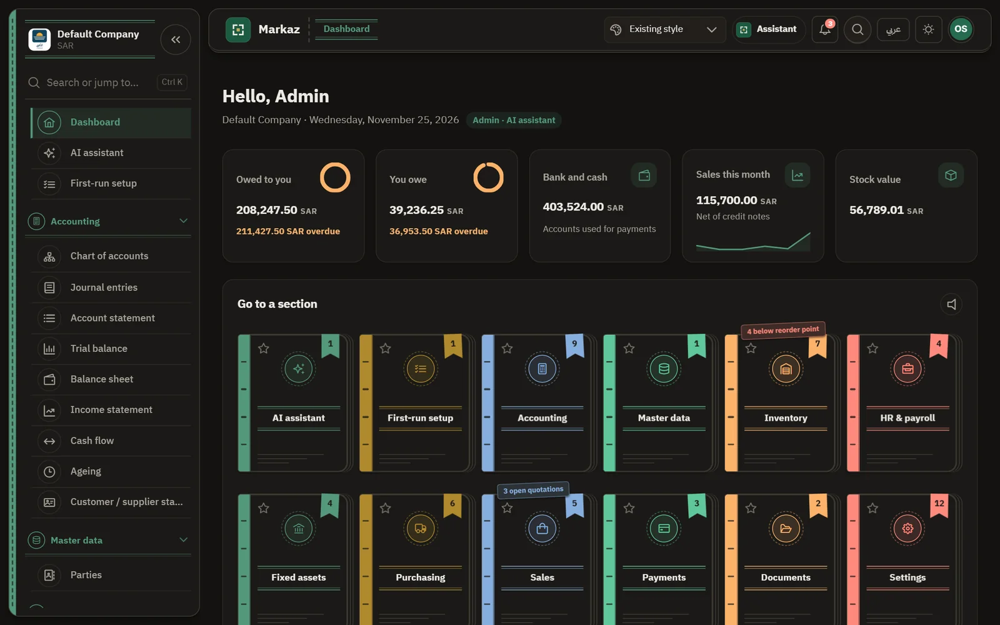
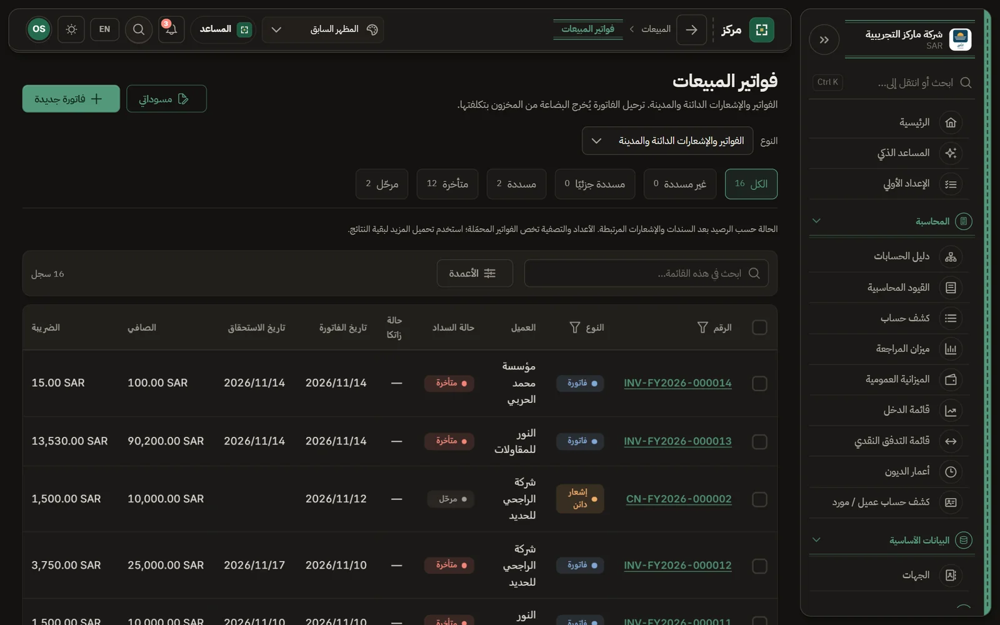
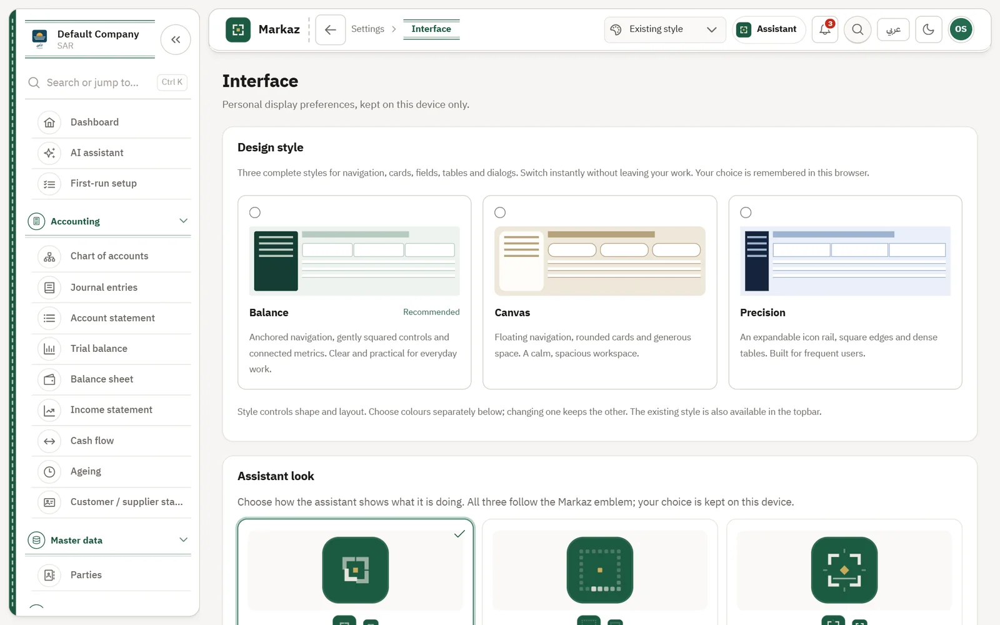
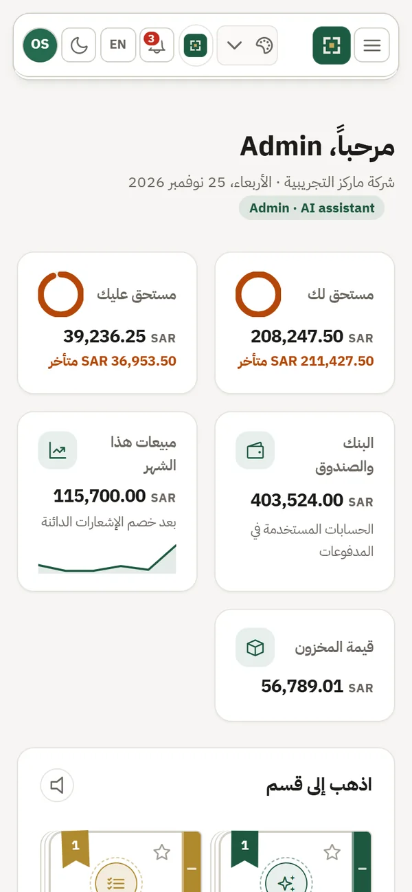
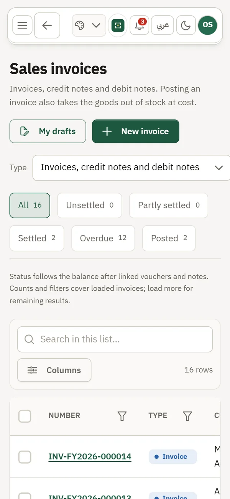

# 🌍 Interface, Arabic & English

> **Arabic-first and English-native — not a translation bolted on later.** Every screen, PDF, email
> and error message ships in both languages, right-to-left and left-to-right, in light and dark,
> on desktop and phone.

[← Wiki home](Home.md) · [Architecture →](Architecture.md)

<table>
<tr>
<td width="50%"></td>
<td width="50%"></td>
</tr>
<tr>
<td></td>
<td></td>
</tr>
</table>

---

## Two languages, two directions

- Switch language from the top bar at any time; the whole layout mirrors instantly.
- **Every user-facing string is a translation key** — there are no hard-coded labels, and CI fails if the
  Arabic and English key sets drift apart.
- Arabic and Western digits are both accepted in amount fields.
- Documents carry bilingual names (items, accounts, parties) and print in the reader's language.

## Three design styles

**Settings → Interface** lets each user pick how Markaz looks — remembered on their device:

| Style | Feel |
|---|---|
| **Balance** *(recommended)* | Anchored navigation, gently squared controls, connected metrics |
| **Canvas** | Floating navigation, rounded cards, generous spacing |
| **Precision** | Expandable icon rail, squared edges, dense tables for frequent users |

Combine any style with a **colour palette** and **light or dark** mode. The assistant's look can be
chosen too.

## Fast to navigate

- **Search or jump** (`Ctrl K`) — go to any page or document from the keyboard.
- **Collapsible sidebar** with groups you can reorder and collapse.
- **Configurable tables** — choose columns, search, filter, select and export.
- **Notification bell** for approvals and AI app requests.

## Works on the phone, installs like an app

&nbsp;&nbsp;

- Fully responsive layouts down to phone width.
- **Installable PWA** with an install prompt and a notification-ready service worker.
- **Offline read-only mode** — recently viewed data stays available when the connection drops.
