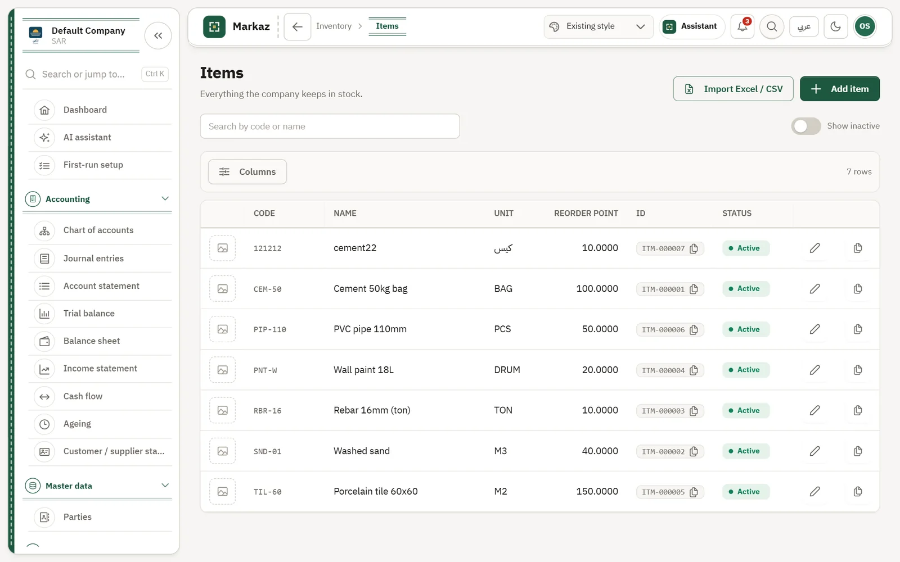
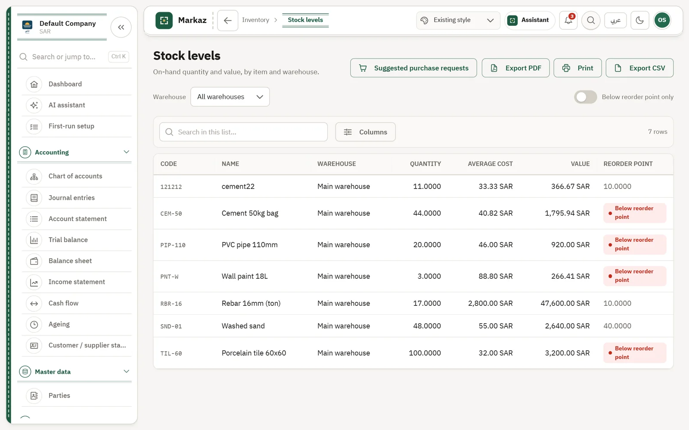
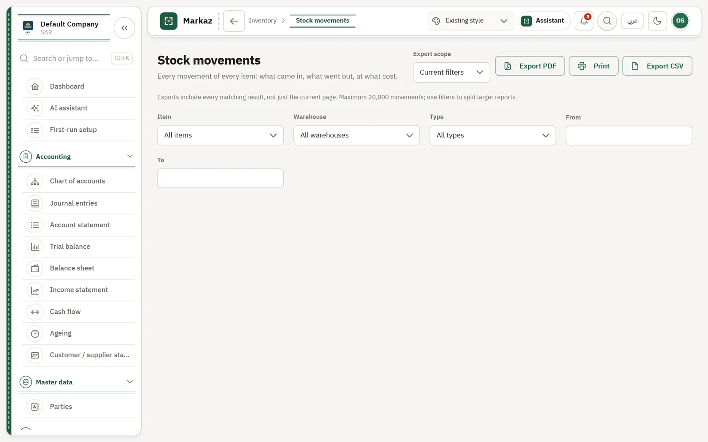

# 📦 Inventory & Stock Control

> **Every unit you hold has one value and one history.** Markaz keeps quantity and value per item
> and warehouse, derives the weighted-average cost from them, and writes each change as an
> append-only movement in the same transaction as its ledger entry.

[← Wiki home](Home.md) · [Purchasing & supplier invoices →](Purchasing.md)

---

## At a glance

| Capability | What you get |
|---|---|
| **Items** | Code, English and Arabic name, unit, UN/ECE unit code, reorder point, picture; deactivated rather than deleted |
| **Stock levels** | On hand, average unit cost and value per item and warehouse, with a below-reorder flag |
| **Movements** | Append-only stock card of every receipt, issue, return and count adjustment, linked to its journal entry |
| **Goods receipts** | Receive stock at cost into a warehouse, directly or against a purchase order |
| **Stock issues** | Issue stock to a project or cost centre at weighted-average cost |
| **Stock counts** | Record a physical count as a draft, then post the variance as shortage or surplus |
| **Replenishment** | Suggested purchase quantities from reorder points, on hand and incoming supply, turned into a reviewable request |

---

## Items

Items are the stock-keeping master data. Each carries a **code** unique inside the company, an
English and an Arabic name, a **unit**, a **reorder point** stored to four decimal places, and an
optional UN/ECE Recommendation 20 unit code used on ZATCA documents (for example `PCE`, `KGM`, `LTR`).

- **Pictures:** stored as an attachment; the list shows the newest picture that has not been removed.
- **Deactivate, don't delete:** once stock movements reference an item it is deactivated, so every
  historical movement and report stays exact.

## Warehouses and locations

Stock is always held in a warehouse: a company-scoped location with a unique code and bilingual name.
An unused warehouse is deactivated rather than removed, and only active ones accept documents.

## Stock levels

**Inventory → Stock levels** is the read-only position of the business: one row per item and
warehouse with quantity on hand, average unit cost, stock value and the item's reorder point.

- **Below reorder** rows carry a tag so a shortage is visible at a glance; a filter shows only those
  rows.
- **Cost status:** a row is marked *provisional* or *pending* when part of its quantity came from a
  shortage whose cost is not final yet. Only a final row is the settled position.
- **Export:** the same warehouse and below-reorder filters drive the PDF and CSV export, so the file
  matches the screen.

When stock is consumed elsewhere — on sales lines, for example — Markaz also shows the quantity
available for the chosen item and warehouse next to the line, and warns when the requested total
would exceed it. The check covers the whole document, so splitting a quantity across lines cannot
slip past it; if availability cannot be read, the field says so rather than assuming zero.

## Stock movements

Every quantity change is a movement, and movements are **append-only**. They are written only by the
posting services — goods receipt, stock issue, stock count and returns — never edited by hand, and
each is typed as a receipt, issue, return, count adjustment or cost adjustment.

Each row shows the item, warehouse, signed quantity, unit cost, value, the source document and, where
there is one, the customer or supplier in both languages. The **entry number** links straight to the
journal entry the movement was posted with.

The stock card exports to **PDF, CSV or print** for the current server filters, for all movements, or
for one selected movement. Local table search is disabled on this page so an export never silently
drops a client-only filter. Reports above **20,000 movements** fail explicitly instead of being
truncated; CSV is the default format and keeps its UTF-8 BOM so Excel opens Arabic correctly.

## Goods receipts

A goods receipt brings stock in at the cost you enter and records where it came from.

1. Open **Inventory → Goods receipts → New**.
2. Choose the warehouse, an optional party and reference, then add lines with item, quantity and unit cost, and post.

Markaz numbers the document (**GRN** series) and posts **Inventory** debit / **GRNI** credit. A
receipt from a purchase order links to its lines and is valued at the order price; a direct receipt
stands alone. Stock, document, movements and entry commit together or not at all.

## Stock issues

A stock issue sends stock out of a warehouse and charges its value to a cost centre. Lines carry an
item and a quantity; the cost is the **weighted-average cost** at posting, and the cost-centre
reference is free text. Markaz posts **project issue expense** debit / **Inventory** credit under the
**SI** series. If part of the quantity has no known cost, the issue stays *provisional* or *pending*.

## Stock counts

A physical count is recorded as a **draft**, then posted once counting is complete.

1. Open **Inventory → Stock counts → New**, choose the warehouse and date, and enter the counted
   quantity per item; the screen shows the system quantity and the difference.
2. Post. Each counted quantity is compared with the stock **at posting time**, so the count means
   "there are exactly N units now"; a shortage debits the count-loss account and a surplus credits
   the count-gain account, and a count that matches the books posts nothing.

A unit cost is captured when the line is recorded. If an item has nothing on hand there is no average
to fall back on, so a cost must be entered for that line before the count can be saved.

## Weighted-average cost

Markaz values stock with a **weighted average per item and warehouse**. The only state stored for a
stock row is quantity and value; the average unit cost is always `value ÷ quantity`, derived on read.

- A **receipt** adds quantity and value together, so the pool blends by value rather than averaging
  unit costs naively.
- An **issue** takes value out at the current average. Issuing the entire remaining quantity takes
  the entire remaining value, so no residual value is left behind with no quantity to hold it.
- Because the average is never stored as a rounded column, the stock sub-ledger and the Inventory
  control account cannot drift apart through accumulated rounding.

## Replenishment

**Stock levels → Suggested purchase requests** turns reorder points into a reviewable buying list.

- Choose an active warehouse, select items and adjust quantities. The suggestion is
  `max(0, reorder point − on hand − pending or accepted requests − unreceived quantities on open
  orders)`; processed requests and closed orders are excluded so a shortage is not counted twice.
- Creating the request produces a normal **pending purchase request**; it never auto-approves a
  purchase and never posts stock or accounting entries. Suggestions are recalculated under a
  warehouse lock, so two people cannot order the same shortage twice; a stale quantity is rejected.

## Importing items

**Items → Import Excel / CSV** loads many items at once from a workbook.

- Download the header template, keep identifiers as text in Excel, then choose an XLSX or UTF-8 CSV
  file. Only the first worksheet is read, and only stored cell values — formulas are not evaluated.
- Limits: 2 MiB compressed input, 10 MiB expanded contents, 200 non-empty data rows, 20 columns and
  a 15-second parse timeout. Unknown, duplicate or blank headers are rejected.
- The preview shows original row numbers, normalised values and each field error, colour-coded by
  readiness; fix the file, or explicitly choose **Import valid rows only**. Item identity is the
  **code**, and no update or overwrite is performed, so the import cannot change an existing item.
- The commit revalidates inside one serializable transaction and writes rows, references and audit
  records together; invalid rows return a validation error, and a concurrent conflict requires a
  refreshed preview.

## Why you can trust it

- **One writer, one history.** Stock rows change only through the posting services; every change is
  paired with an append-only movement row, and no screen or endpoint edits a balance directly.
- **All-or-nothing posting.** Document, movement, journal entry and counters commit in one
  transaction; a failure on the last line rolls back the first.
- **Derived cost, fully audited.** Average cost is computed from quantity and value on every read, so
  the stock sub-ledger agrees with the control account; corrections are new documents, and every
  posting writes an audit record with the actor, document and correlation id.
- **Explicit limits.** Large exports fail with a clear message instead of returning a quietly
  truncated file.

See [Accounting & general ledger](Accounting.md) for the posting engine and [Purchasing & supplier
invoices](Purchasing.md) for how receipts become supplier invoices.
