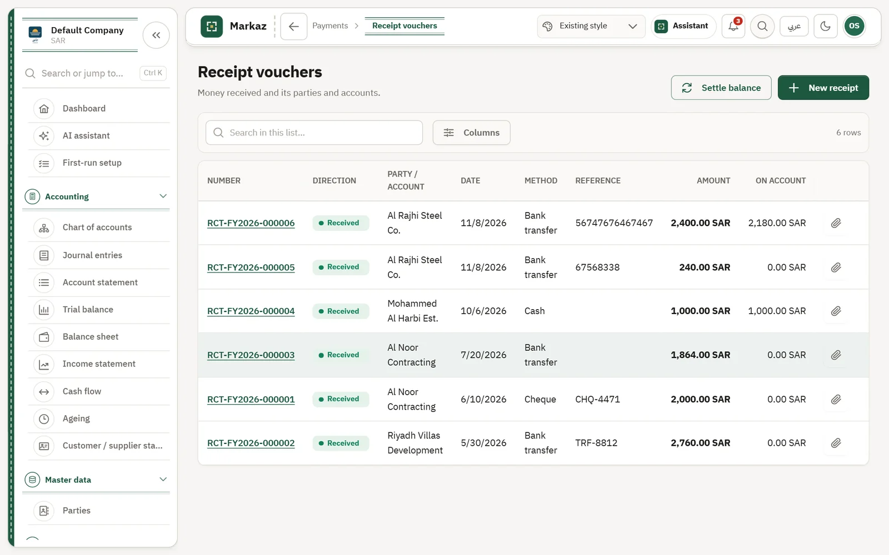
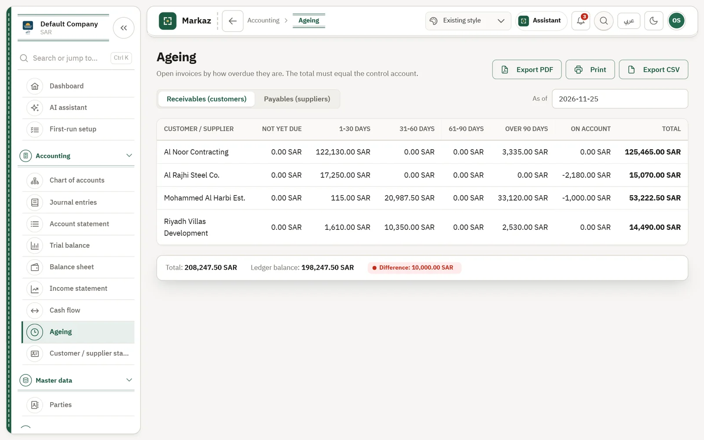

# 💳 Payments, Cash & Expenses

> **Money in, money out — always matched, always explained.** Receipt and payment vouchers settle
> invoices precisely, cash expenses are split across accounts and cost centers, and every reversal
> keeps the full story.

[← Wiki home](Home.md) · [HR & payroll →](HR-and-Payroll.md)

---

## At a glance

| Capability | What you get |
|---|---|
| **Receipt vouchers** | Collect from customers — or receive from suppliers, employees or any account |
| **Payment vouchers** | Pay suppliers — or refund customers, pay employees or any account |
| **Invoice allocation** | "Settle now" allocates one voucher across several open invoices |
| **Smart bank/cash picker** | Cash shows only cash accounts; transfers, cheques and cards show only bank accounts |
| **Cash expenses** | Multi-line petty-cash expenses with account, amount and cost center per line |
| **Cost centers** | Cost centers, projects and departments on every expense line |
| **Statements & ageing** | Customer / supplier statements and receivables / payables ageing |

---

## Receipt & payment vouchers

Each voucher has a **counterparty type** — *Customer*, *Supplier*, *Employee* or *Account* — and a
**payment method** — cash, bank transfer, cheque, card or other.

| Voucher | Debit | Credit |
|---|---|---|
| Receipt | Selected bank / cash account | Counter-account |
| Payment | Counter-account | Selected bank / cash account |

- Customers post against the receivables control account; suppliers against payables.
- Parties that are both customer **and** supplier appear in both lists.
- The bank/cash list is driven by **configurable account folders** (Settings → Account mapping), not
  by account names — and the server enforces the same rule when posting.

### Settle now

Open **Settle** to allocate a receipt across a customer's open invoices (or a payment across a
supplier's bills):

- Type amounts per invoice — Arabic (٠١٢٣) and Western digits both work.
- Leave the voucher total blank and it's calculated from your allocations; enter a larger total and the
  remainder stays **on account**.
- Posting is blocked if an allocation exceeds the invoice's outstanding balance or the voucher total.

### Reversals

Reversing a voucher mirrors the **actual original journal lines** — even if account settings changed
since. The original allocations stay recorded and stop counting from the reversal date. A reversal can't
itself be reversed, and amounts are never edited.

## Cash expenses

Record day-to-day spending paid from a cash or bank account:

- Multiple lines per expense, each with its own expense account, amount and **cost center**.
- Manage the cost-center directory (cost centers, projects, departments) right from the form.
- The expense posts one balanced journal entry; reversing it preserves the cost-center links.

## Statements & ageing

- **Ageing** — receivables and payables bucketed by days overdue (not yet due, 1–30, 31–60, 61–90, over 90 days),
  with on-account balances shown separately and a check that the total matches the ledger.
- **Customer / supplier statement** — opening balance, every document and payment, running balance;
  print or export.

See [Sales & receivables](Sales-and-Receivables.md) and [Purchasing](Purchasing.md).
