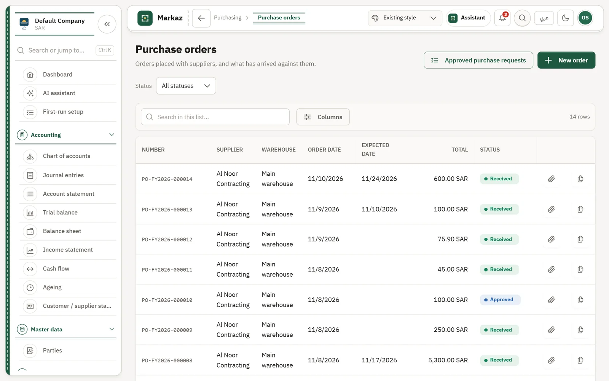
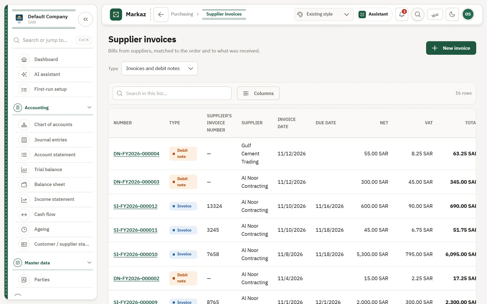

# 🛒 Purchasing & Supplier Invoices

> **Buy only what was asked for, receive only what was ordered, and pay only for what arrived.**
> Markaz carries a purchase from request to approval, order, receipt and supplier invoice — and
> matches the invoice against both the order price and the quantity actually received.

[← Wiki home](Home.md) · [HR & payroll →](HR-and-Payroll.md)

---

## At a glance

| Capability | What you get |
|---|---|
| **Purchase requests** | An internal request for stock, reviewed and accepted or rejected before anyone buys |
| **Approval policy** | An optional amount threshold per document type; orders above it wait for an approver |
| **Purchase orders** | Supplier, warehouse, prices and tax codes, with a status that gates receiving |
| **Goods receiving** | Receive against an approved order, never above the outstanding quantity |
| **Supplier invoices** | Three-way matching, price-variance acceptance, expense and fixed-asset lines |
| **Tax codes** | Standard, zero-rated, exempt and out-of-scope treatments, copied onto every line |
| **Purchase returns** | Debit notes linked to the original invoice, with stock and VAT reversed correctly |

---

## Purchase requests

A purchase request records what someone needs. It is deliberately not a buying document: it moves
nothing in stock and posts nothing to the ledger. Every request names the warehouse the goods are
wanted in and carries one or more item lines with a quantity.

A request moves through **PENDING** (waiting for review), **ACCEPTED** (a buyer may order),
**PROCESSED** (an order was created) or **REJECTED** (with a reason recorded).

An order can only be created from an **accepted** request, and the request then becomes processed.
This is what stops a stale or already-used request from quietly becoming an unrelated order.

## Approval policy

Approval is opt-in. **Settings → Approvals** holds one threshold per document type; a type with no
policy never waits for approval. When a policy exists, an order whose total is **strictly above**
the threshold is created as **PENDING_APPROVAL**; an order exactly at the threshold does not wait.

The approver needs the approval permission, and a decision applies to the same approval record the
rest of the system uses. An order below the threshold — or one with no policy — is **APPROVED** at
creation.

## Purchase orders

A purchase order commits one supplier to one receiving warehouse at agreed prices, with an order
date, an optional expected date, notes and lines of item, quantity, unit price and tax code.

Orders do **not** touch the ledger. Nothing is owed until goods arrive; the order fixes the price
the receipt will be valued at and the quantity that may be received. Its tax is a display estimate;
the supplier invoice recomputes tax independently when matched.

| Status | Meaning |
|---|---|
| **PENDING_APPROVAL** | Above the approval threshold, waiting for a decision |
| **APPROVED** | Ready to receive |
| **PARTIALLY_RECEIVED** | Some quantity has arrived |
| **RECEIVED** | Every line is fully received |
| **REJECTED** | Refused at approval |
| **CANCELLED** | Withdrawn before any goods arrived |

Only a pending or approved order can be cancelled; once goods have been received the receipt is in
the ledger, and the order is closed by receiving or a correction document instead.

## Receiving goods

**Purchasing → Purchase orders → Receive** books a receipt against an approved or partially received
order. Choose the lines and quantity arriving now; a line may appear twice and the bound applies to
the sum. Markaz refuses any quantity above what is still outstanding, and values the receipt at
the **order price**, not at a price typed at the gate.

The receipt posts **Inventory** debit / **GRNI** credit — the same goods-receipt entry used
elsewhere in the system — and updates each line's received counter. The order becomes
**PARTIALLY_RECEIVED** or **RECEIVED** from those counters, in the same transaction.

The order row is locked while receiving, so two people cannot both take the last unit. If the
transaction fails, the receipt, the counters and the status all roll back together.

## Supplier invoices

A supplier invoice records what the supplier charged. It is numbered in the **SI** series and
posts only when it matches the order and the receipt:

- **Quantity:** the invoiced quantity cannot exceed what has been received and not yet invoiced.
- **Price:** a difference from the order price is calculated and shown. Nothing is absorbed
  silently — the difference must be **explicitly accepted** before the invoice can post.
- **Supplier:** every matched order line must belong to the same supplier as the invoice.
- **Duplicate number:** the same supplier invoice number cannot be entered twice for the supplier.

A line is one of three kinds: a **purchase-order line**, a direct **expense** line with its own
account, or a **fixed-asset** line with a category. An asset line debits the category's asset
account and registers the asset in the same transaction.

### What posting writes

| Line | Entry |
|---|---|
| Goods received | **Dr GRNI** at quantity × order price |
| Price difference | **Dr/Cr purchase price variance** for invoice net − order value |
| Direct expense | **Dr** the chosen expense account |
| Fixed asset | **Dr** the category's asset account |
| Tax | **Dr Input VAT** |
| Amount owed | **Cr Accounts payable** at the gross total |

The entry balances by construction: GRNI plus price variance plus expense and asset lines equals
the invoice net, and net plus tax equals the gross payable. Debit notes follow the mirror image.

## Tax codes

Each tax code has a code, an English and Arabic name, a rate and one treatment: **STANDARD**,
**ZERO_RATED**, **EXEMPT** or **OUT_OF_SCOPE**. Only a standard-rated code may carry a percentage
above zero.

A code's **rate and treatment never change after creation**, because invoice lines copy them when
posted. A different rate means a new code and deactivating the old one. A Saudi starting set can be
added in one click, including a standard 15% code, but never silently.

## Purchase returns and debit notes

**Purchasing → Purchase returns** starts from the original supplier invoice. Select the quantities
to return, the warehouse holding the goods and an optional reason. The document is numbered in the
**DN** series.

- **Capped twice:** a return cannot exceed the remaining quantity on the original line, and all
  debit notes together cannot exceed the invoice's gross value.
- **Original terms:** linked returns use the original line's stored price, tax code, rate and
  amounts, even if today's tax configuration has changed.
- **Stock at current cost:** stock lines leave inventory at the selected warehouse's current
  weighted-average cost. The difference between invoice net and stock cost goes to purchase price
  variance.
- **Posting:** **Dr Accounts payable**, **Cr Input VAT**, and **Cr** the original expense account or
  **Inventory** for stock lines.
- **No cash movement; assets are not returned.** A return against a paid invoice leaves a credit
  balance for normal reporting, and a fixed-asset line must be disposed of instead.

The return date cannot precede the invoice, all lines must be valid, and document, journal, stock
movements and counters commit atomically. Older goods returns remain read-only.

## Why you can trust it

- **Three-way match, not a best guess.** Quantity is checked against the receipt, price against the
  order, and the whole invoice against the supplier — before anything posts.
- **No silent variance.** Any price difference must be accepted explicitly; over-receipt and
  over-return are refused with the line that caused them.
- **One transaction, immutable history.** Document, lines, journal, stock movements and counters
  commit together or not at all; posted invoices and debit notes are corrected by new documents, and
  returns lock the invoice while they are created.
- **Every posting audited.** The audit record carries the actor, document, amounts and correlation
  id, and the journal links back to the document that produced it.

See [Inventory & stock control](Inventory.md) for receipts and weighted-average cost, and
[Accounting & general ledger](Accounting.md) for the posting engine.
