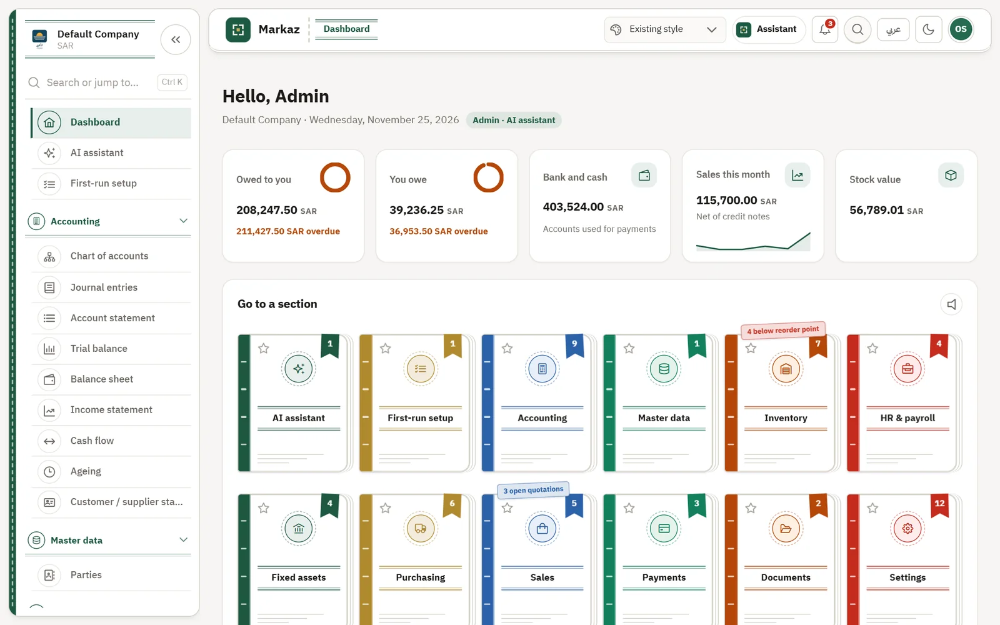
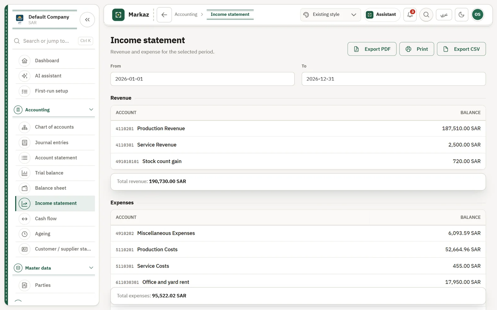
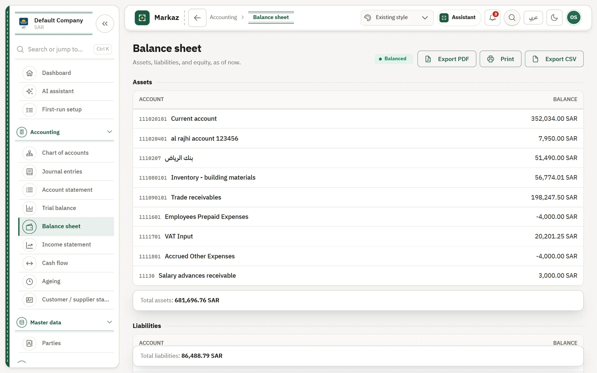
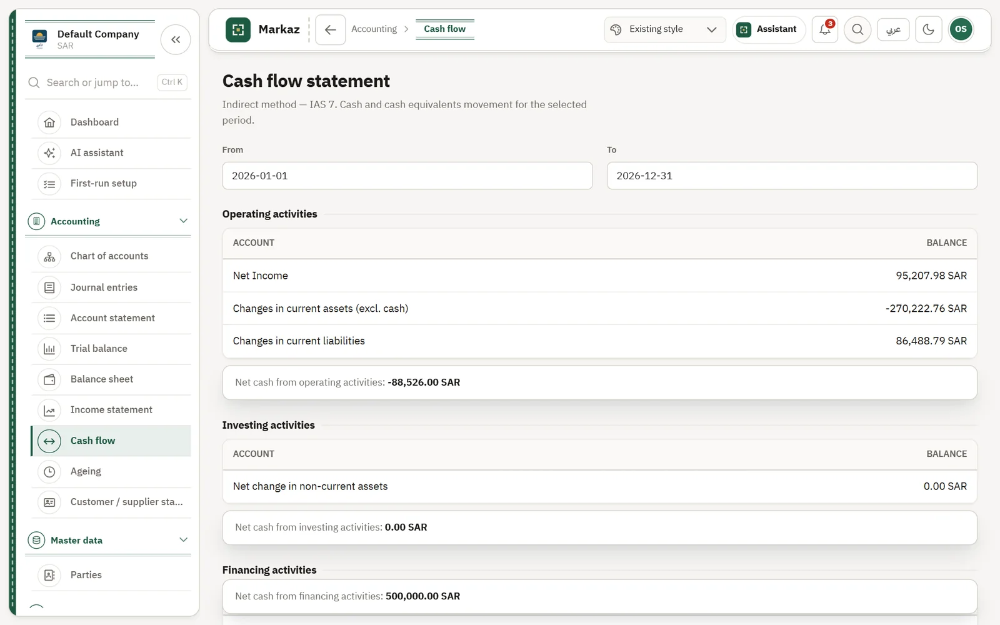
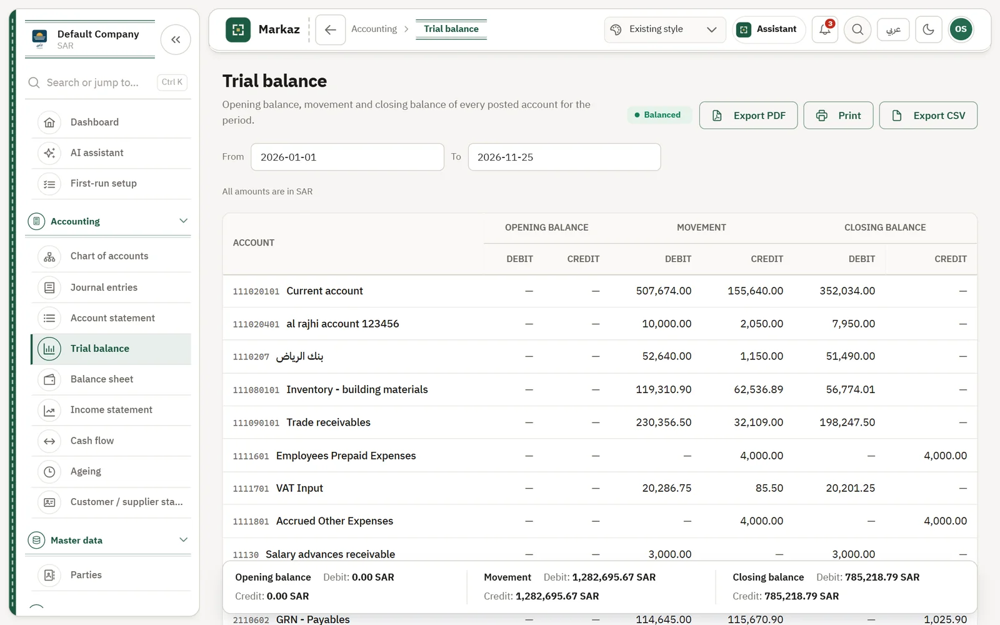

# 📊 Reports & Dashboard

> **The numbers that matter, the moment you sign in.** A live dashboard for the day-to-day, and
> a complete set of financial statements for the month-end — every one exportable, every one
> reconciled to the ledger.

[← Wiki home](Home.md) · [Security & administration →](Security-and-Administration.md)

---

## The dashboard

| Tile | Shows |
|---|---|
| **Owed to you** | Total receivables, with the overdue part highlighted |
| **You owe** | Total payables, with the overdue part highlighted |
| **Bank and cash** | Balance of the accounts used for payments |
| **Sales this month** | Net of credit notes, with a sparkline trend |
| **Stock value** | Inventory at weighted-average cost |

Below the tiles, **Go to a section** opens every module from a colour-coded card that carries live
badges — items below reorder point, open quotations and more — and can be pinned as a favourite.
Dates follow the company's time zone.

## Financial reports

| Report | Module | Highlights |
|---|---|---|
| Trial balance | Accounting | Opening, movement and closing per account; balanced badge |
| Balance sheet | Accounting | As of any date, grouped by chart hierarchy |
| Income statement | Accounting | Revenue, expenses and net income for a period |
| Cash flow | Accounting | Indirect method — operating, investing, financing |
| Account statement | Accounting | Running balance for any account |
| Receivables / payables ageing | Payments | Buckets by days overdue, ledger reconciliation |
| Customer / supplier statement | Payments | Every document and payment with running balance |
| Stock levels & movements | Inventory | Quantity, average cost and value per warehouse |
| Fixed-asset register & movement | Fixed assets | As-of register, movements, ledger reconciliation |
| Payroll & WPS | HR | Payroll runs, payslips, bank salary file |

<table>
<tr>
<td></td>
<td></td>
</tr>
<tr>
<td></td>
<td></td>
</tr>
</table>

## Export everywhere

Every report and list can be **printed**, saved as a **PDF** on your letterhead, or exported to **CSV**.
Lists also let you choose visible **columns**, search, filter, and export only the selected rows.

## Accurate by construction

Reports are calculated from posted journal lines at request time — there are no cached totals to drift
out of sync. Ageing and fixed-asset reports include a reconciliation against the ledger so a difference
is visible immediately.
