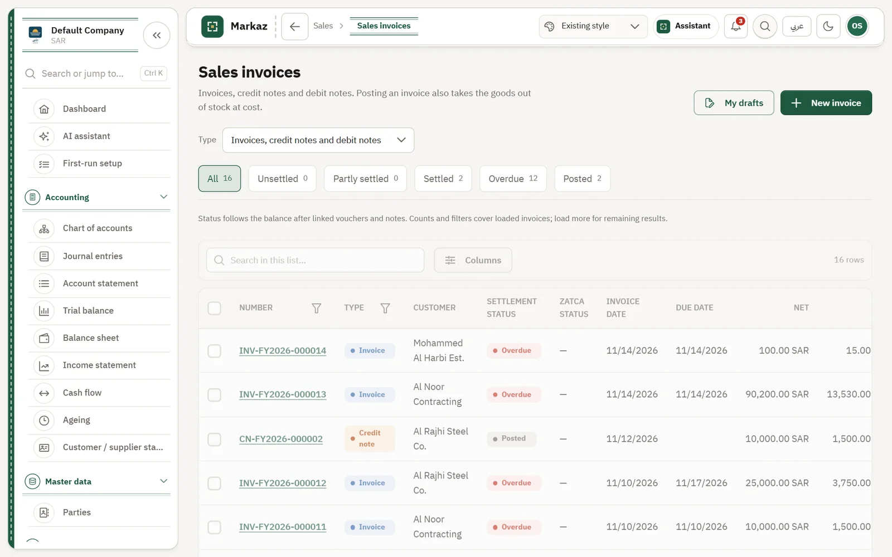
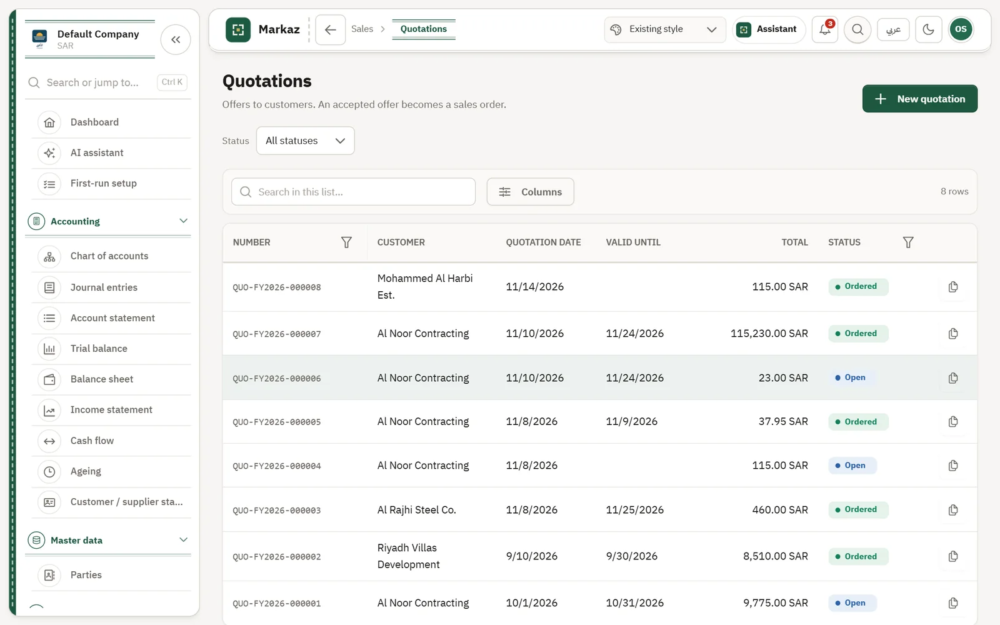
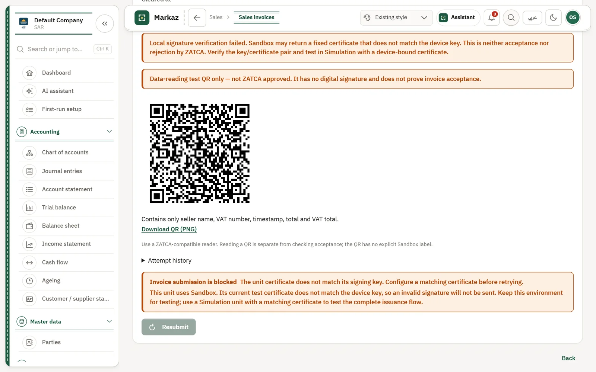

# 🧾 Sales & Receivables

> **From the first quotation to the last riyal collected.** Quotations, orders, delivery notes,
> invoices, returns and receipts are one connected flow — every step linked, every amount posted,
> every invoice ready for ZATCA.

[← Wiki home](Home.md) · [Payments & cash →](Payments-and-Cash.md)



---

## At a glance

| Capability | What you get |
|---|---|
| **Quotations** | Priced offers with validity dates; email them as a branded PDF, then convert, reject or cancel |
| **Sales orders** | Confirmed customer orders that feed delivery and invoicing |
| **Delivery notes** | Ship goods out of a chosen warehouse, with stock availability checked before posting |
| **Sales invoices** | Revenue, output VAT, receivable and cost of goods sold posted in one transaction |
| **Credit & debit notes** | Financial adjustments or full quantity returns linked to the original invoice |
| **Settlement status** | Every invoice shows Unsettled / Partly settled / Settled / Overdue with its outstanding balance |
| **Printing & PDF** | Bilingual letterhead, amounts in words (Arabic and English), page numbers, ZATCA QR |

---

## The sales flow

```
Quotation ──convert──► Sales order ──► Delivery note ──► Sales invoice ──► Receipt voucher
                                                            │
                                                            └──► Credit note / Debit note (returns & adjustments)
```

Every document remembers where it came from. The **document trail** on each page shows the linked
documents as cards you can click through, and the **Activity** tab shows who did what and when.

## Quotations



- Build a quotation from items with prices and tax codes; totals update as you type.
- **Email it** straight from Markaz: the customer receives a branded, language-aware email with the
  PDF attached. Every send attempt is stored with its status, so you can see what was sent, check
  delivery with the provider and resend deliberately.
- **Convert** an accepted quotation into a sales order without retyping a line.
- **Reject** or **cancel** it when the deal is off — the document and its history stay.

## Sales invoices

Posting an invoice does all of this atomically:

| Debit | Credit |
|---|---|
| Accounts receivable (total incl. VAT) | Sales revenue (net) |
| | Output VAT |
| Cost of goods sold (at weighted-average cost) | Inventory |

- **Stock guard:** Markaz shows warehouse availability while you enter lines and refuses to consume
  more stock than exists.
- **Service lines** post revenue without moving stock.
- **Gapless numbering** per fiscal year, issued inside the posting transaction.
- **Settlement tracking:** receipts, credit notes and debit notes are netted against each invoice.
  Filter by status, select rows and export just those to CSV.



## Returns, credit notes & debit notes

Open the original invoice and choose **Sales return**. Pick quantities (never more than remains after
earlier returns), the receiving warehouse and an optional reason. Markaz:

- reverses revenue and output VAT using the **original line's stored price and tax rate**, even if your
  tax configuration has changed since;
- returns the goods to stock at their **original cost**;
- allocates partial amounts so the final return consumes the exact remainder — no rounding drift.

Returns don't move cash automatically. A return on a paid invoice leaves a credit balance that you
settle through a payment voucher.

## Receivables reporting

- **Ageing** — receivables bucketed by days overdue, per customer.
- **Customer statement** — every invoice, note and receipt with a running balance, printable on
  letterhead.
- **Dashboard** — "Owed to you" with the overdue part highlighted.

See [Reports & dashboard](Reports-and-Dashboard.md) and [ZATCA e-invoicing](ZATCA-E-Invoicing.md).
