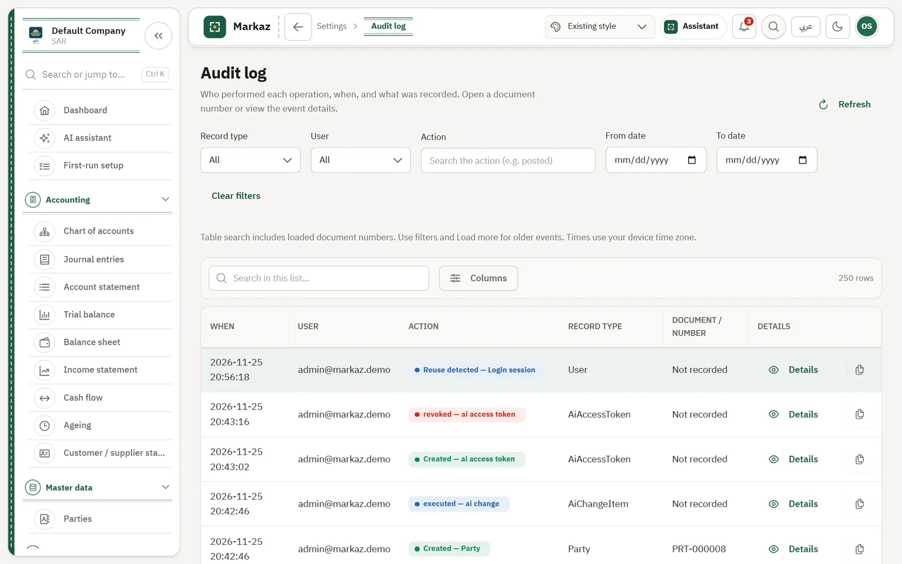
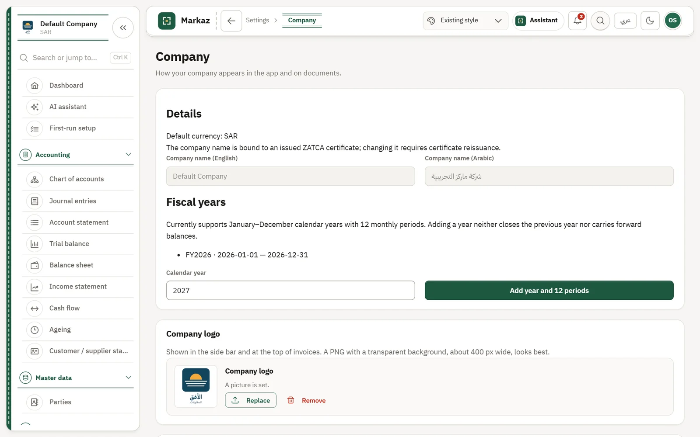

# 🔐 Security & Administration

> **Who can do what — and a permanent record of what they did.** Role-based permissions that deny
> by default, an append-only audit log the application itself cannot rewrite, and encrypted
> secrets everywhere.

[← Wiki home](Home.md) · [Interface & localization →](Interface-and-Localization.md)

---

## At a glance

| Capability | What you get |
|---|---|
| **Users & roles** | Invite users, assign one or more roles, deactivate without losing history |
| **Permissions as data** | Fine-grained permissions (`sales_invoice:create`, `account:read`…), deny by default |
| **Audit log** | Every operation: who, when, what, before and after — filter, search and drill into details |
| **Secure sessions** | JWT access tokens with refresh-token rotation and reuse detection |
| **Encrypted secrets** | ZATCA keys, AI provider keys and bot tokens sealed with AES-256-GCM |
| **First-run setup** | Guided company setup: profile, fiscal year, chart of accounts, defaults |
| **Company settings** | Legal names, currency, calendar-year fiscal periods, logo |

---

## Users, roles & permissions

**Settings → Users & roles.** A role is a named set of permissions; a user can hold several roles. Every
API endpoint declares the permission it needs, and anything not explicitly granted is denied. The web app
hides what a user can't use, but the server is what enforces it.

Built-in roles such as *Admin* and *Accountant* are created at setup; you can add your own.

## The audit log

**Settings → Audit log** records every state change with the user, time, action, record type, document
number and a structured *before / after* view. Filter by record type, user, action and date range.

The log is **append-only at the database level**: the application connects through a Postgres role that
has no `UPDATE` or `DELETE` grant on audit tables. Not even a bug in Markaz can rewrite history. Changes
made by the AI assistant or a chat bot carry their channel and correlation id.

## Sessions & authentication

- Short-lived access tokens plus rotating refresh tokens. Re-using an old refresh token is
  detected and treated as a stolen session.
- Deactivated users lose access on their next request — in the web app, the AI assistant and chat bots.

## Secrets & sensitive data

| Secret | Protection |
|---|---|
| ZATCA private keys & CSIDs | Envelope-encrypted, never logged, never returned by an API |
| AI provider API keys | AES-256-GCM, write-only in the API |
| Chat-bot tokens | AES-256-GCM; the API returns only "set" and the last 4 characters |
| Passwords | Hashed; never stored or logged in plain text |

Encryption keys come from the environment, never from the database. No secret ever lives in source code.

## First-run setup & company

The **First-run setup** checklist walks a new company through its profile, fiscal year and periods, the
chart of accounts template, account mapping and defaults. **Settings → Company** holds the legal names,
default currency, fiscal calendar and the logo used on every PDF and email.

