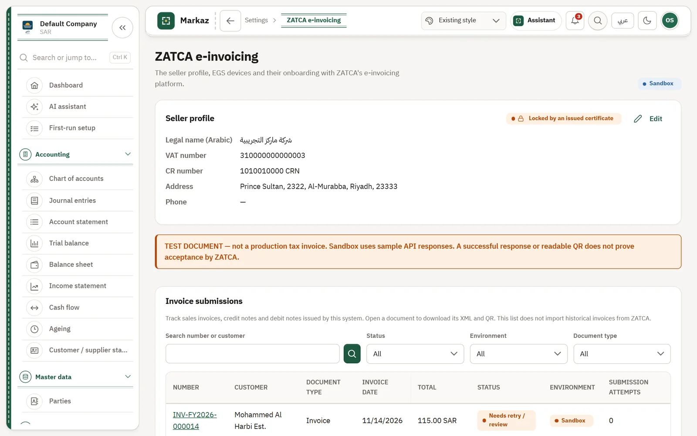
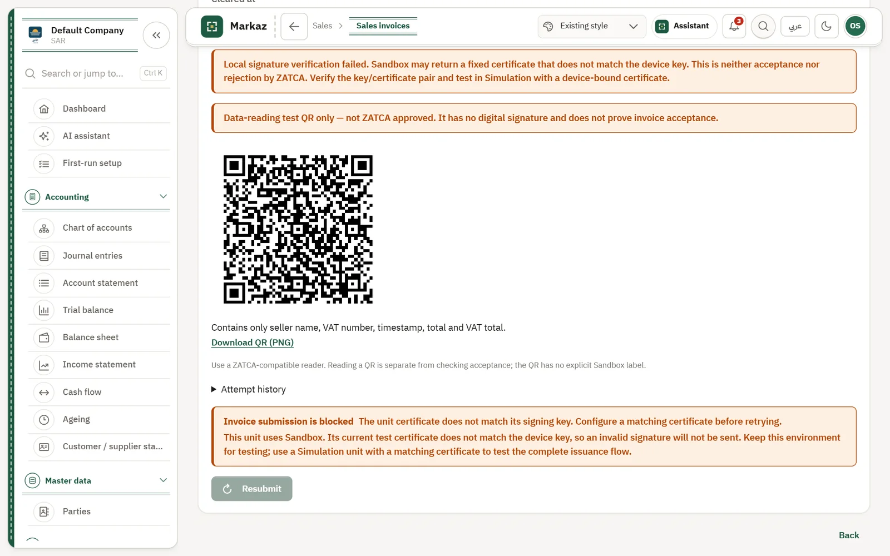

# 🇸🇦 ZATCA E-Invoicing (Fatoora)

> **Built for Phase 2 from the ground up.** Markaz generates, hashes, signs and submits UBL 2.1
> e-invoices, prints the cryptographic QR on every invoice, and keeps the full submission history —
> all inside an isolated compliance pack that never leaks into the accounting core.

[← Wiki home](Home.md) · [AI assistant →](AI-Assistant.md)



---

## At a glance

| Capability | What you get |
|---|---|
| **Seller profile** | Legal name (Arabic), VAT number, CR number and national address in one place |
| **EGS onboarding** | Generate a key and CSR, obtain a compliance CSID, run compliance checks, obtain a production CSID |
| **Six document types** | Standard and simplified × invoice, credit note and debit note |
| **Signed XML** | UBL 2.1 XML, canonicalised, SHA-256 hashed and signed with XAdES (ECDSA) |
| **Invoice chain** | ICV counter and previous-invoice hash advanced atomically per EGS unit |
| **QR code** | TLV-encoded QR printed on the invoice PDF |
| **Clearance & reporting** | Standard invoices are cleared, simplified invoices reported |
| **Submission history** | Every attempt, response, warning and error recorded; retry, download XML |
| **Local validation** | Offline consistency checks, signature verification and the official SDK validator |

---

## How it works

```
Sales invoice posted ─► compliance pack builds UBL XML ─► hash + sign + QR ─► submit to ZATCA
                                                                              │
                                     status, warnings, cleared XML ◄──────────┘
```

1. **Seller profile.** Enter the company's ZATCA details once under **Settings → ZATCA e-invoicing**.
   Customers that are VAT-registered businesses get a buyer VAT number and national address.
2. **Onboard an EGS unit** (an e-invoice generation solution — one per device or branch) with the
   OTP from the Fatoora portal. Markaz generates the key pair and CSR, then requests the compliance
   and production CSIDs.
3. **Post invoices as usual.** Sales invoices, credit notes and debit notes are wired to the compliance
   pack automatically; the invoice page shows the ZATCA status, the QR, and every submission attempt.
4. **Monitor & retry.** The submissions table filters by status, environment and document type.
   Failed attempts can be retried; the signed and cleared XML can be downloaded.



## Environments

Markaz supports ZATCA's **Sandbox**, **Simulation** and **Production** environments. Sandbox
documents are clearly labelled as test documents and are never presented as tax invoices.

## Security of tenant key material

- Private keys and CSIDs are stored **encrypted** (AES-256-GCM envelope encryption). The encryption
  key comes from the environment, never from the database.
- Key material is **never logged and never returned by any API.**
- The ICV/PIH chain is advanced under a row lock in the same transaction that builds the invoice,
  so two invoices can never share a position in the chain.

## Architecture: a compliance *pack*

All ZATCA logic lives in `packages/compliance/zatca-sa`, behind a country-agnostic contract
(`packages/compliance/contract`). The sales module and the accounting core never mention ZATCA. Adding
another Gulf country's e-invoicing regime means adding a new pack — not touching the ledger.

## Status

| Area | Status |
|---|---|
| XML generation, hashing, signing, QR | ✅ Built, cross-checked against the official SDK samples |
| Compliance CSID against the real ZATCA sandbox | ✅ Verified |
| Local validation with the official SDK | ✅ Built |
| Live Simulation / Production onboarding, clearance and reporting | ⏳ Requires the taxpayer's own authorised Fatoora portal access |

> Tax rules and e-invoicing specifications change. Always confirm behaviour against ZATCA's current
> official documentation before going live.
